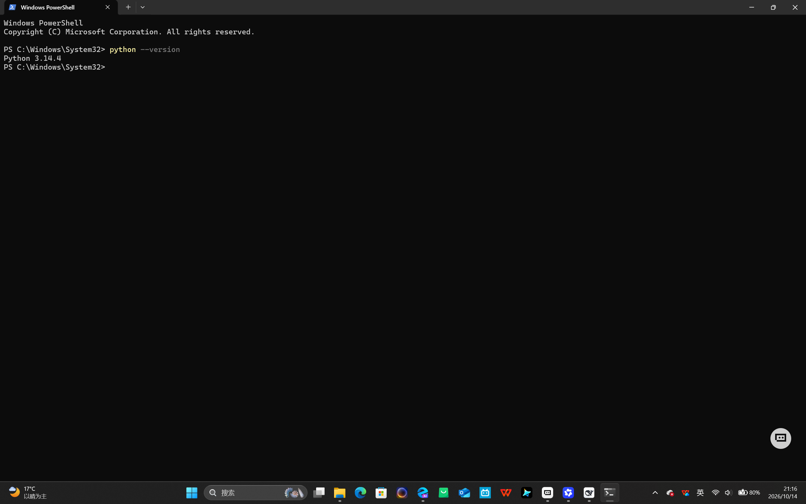
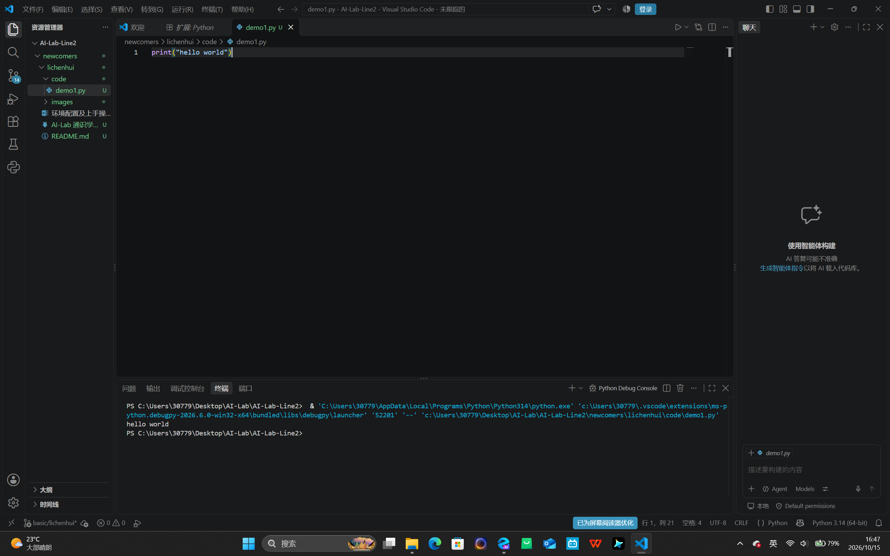
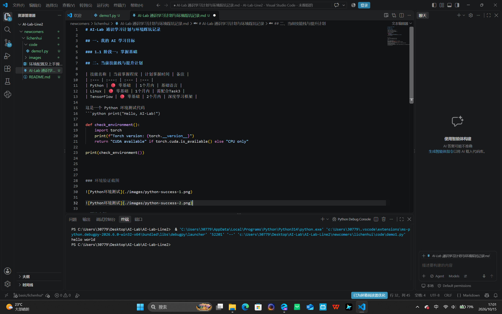
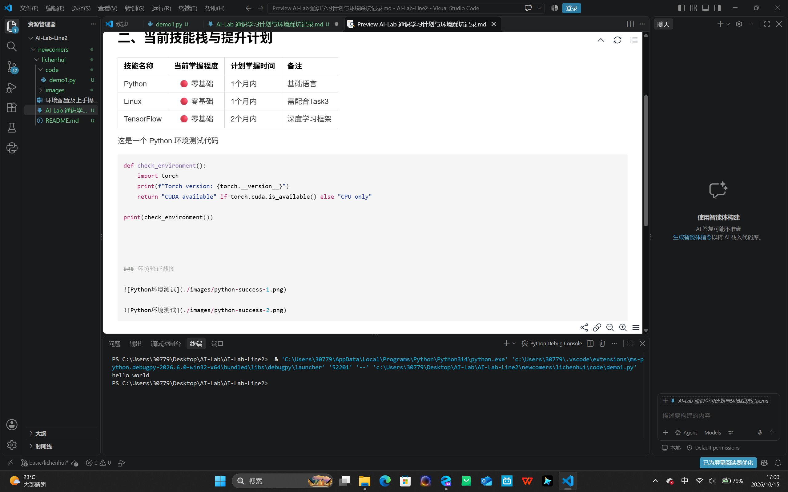
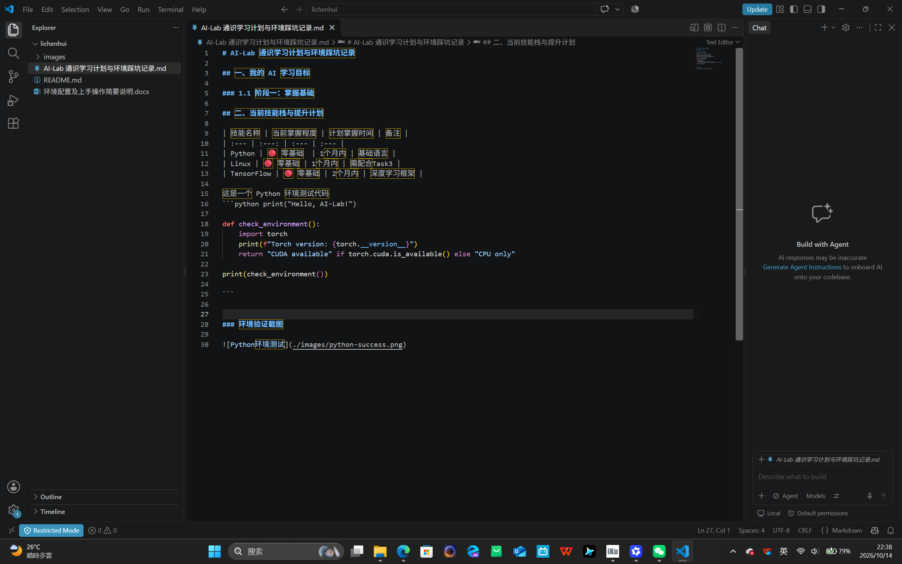
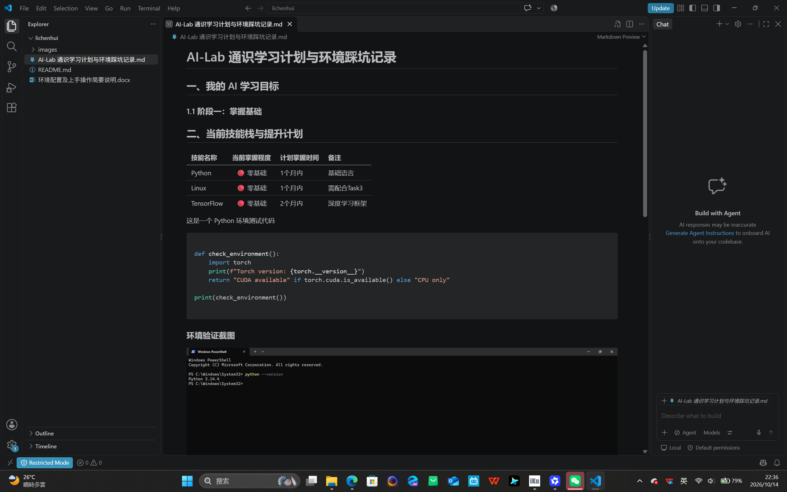

# AI-Lab 通识学习计划与环境踩坑记录

## 一、我的 AI 学习目标

### 1.1 阶段一：掌握基础

## 二、当前技能栈与提升计划

| 技能名称 | 当前掌握程度 | 计划掌握时间 | 备注 |
| :--- | :---: | :--- | :--- |
| Python | 🔴 零基础  | 1个月内 | 基础语言 |
| Linux | 🔴 零基础 | 1个月内 | 需配合Task3 |
| TensorFlow | 🔴 零基础 | 2个月内 | 深度学习框架 |

这是一个 Python 环境测试代码
```python print("Hello, AI-Lab!")

def check_environment():
    import torch
    print(f"Torch version: {torch.__version__}")
    return "CUDA available" if torch.cuda.is_available() else "CPU only"

print(check_environment())

```


### 环境验证截图






## 踩坑实例


###  踩坑一：PyTorch 未安装报错
在运行环境检查代码时，遇到了 `No module named 'torch'` 的错误。
经过查阅AI，是因为没有安装 PyTorch 库。
解决方法：在终端执行 `pip install torch torchvision torchaudio` 命令安装即可。

###  踩坑二：Python  未安装在VS Code上的对应插件
在接入Python时，不明白怎么在VS Code上运行Python，经查询资料，是由于未安装VS Code上的插件导致。
解决方法：跟随教程安装对应插件即可。
  
###  踩坑三：在撰写md笔记文档时格式错误
在撰写该笔记文件时，想在python代码后附带截图，结果忘记添加高亮结束的反引号，导致下一行的标题被错误引用到当前代码串之中，如图：





#### 添加反引号后则成功显示并恢复正常



