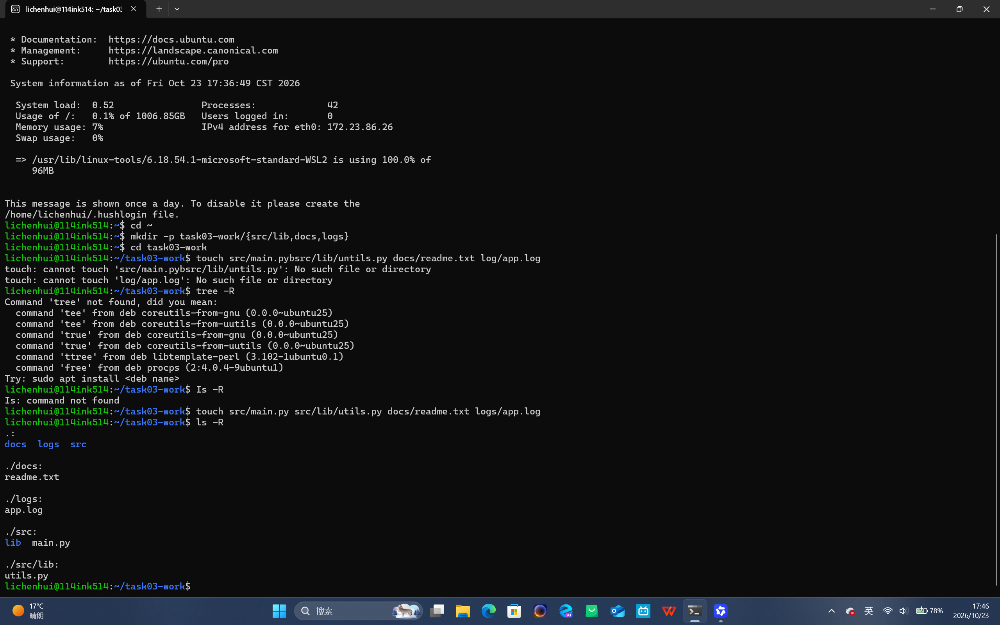
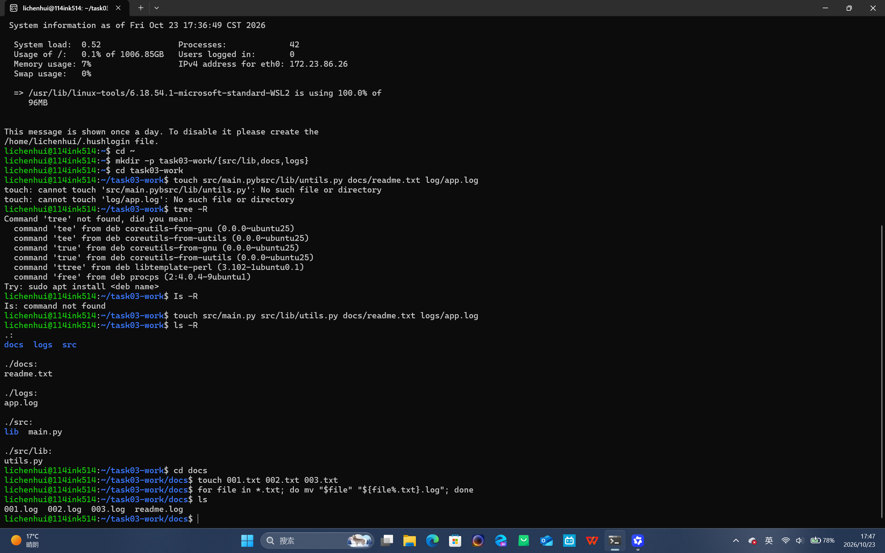
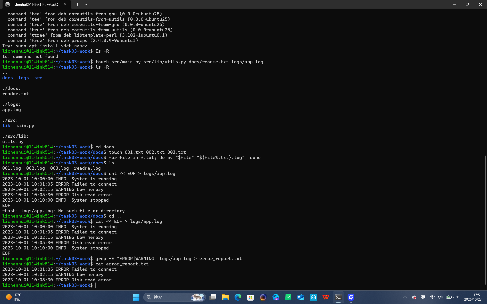
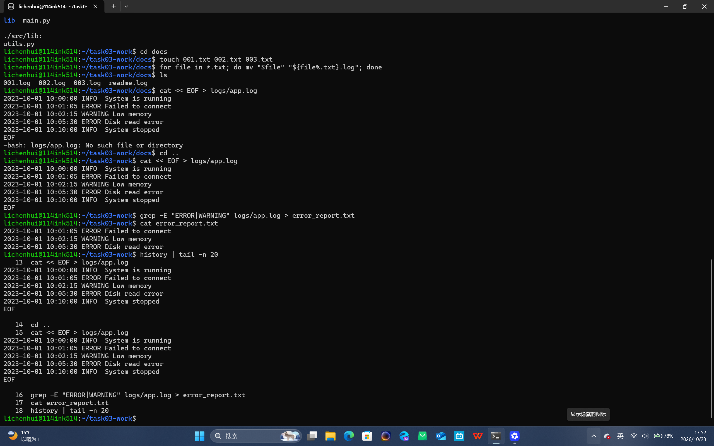

# Task 03 完成情况汇报

## 1. 目录树创建
使用 `mkdir -p` 创建了项目结构，并用 `ls -R` 查看。

## 2. 批量重命名
进入 docs 目录，使用 `for` 循环配合 `mv` 命令将 `.txt` 后缀统一修改为了 `.log`。

## 3. 日志过滤
回到主目录，使用 `grep` 提取关键错误信息并重定向到新文件 `error_report.txt`。

## 4. 执行历史
使用 `history` 命令查看执行过程。

## 5. 快捷md创建
使用 `cat << EOF >` 代码快捷写入 `md` 文件。

