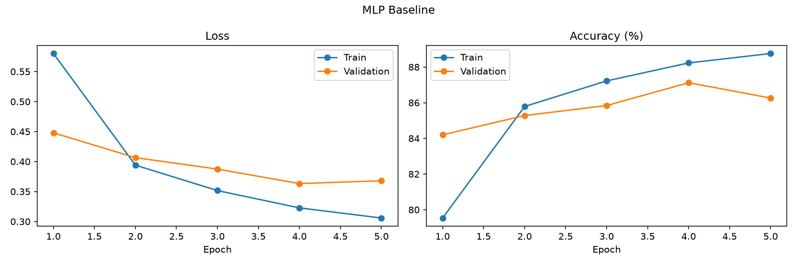
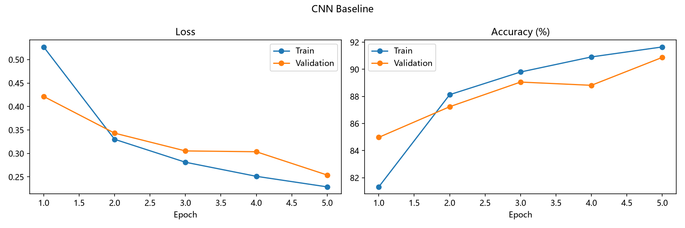
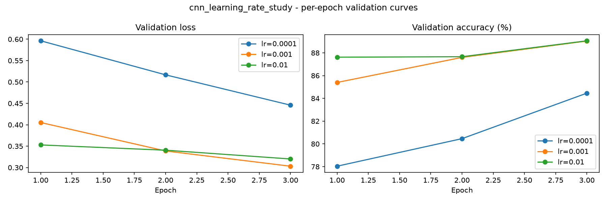
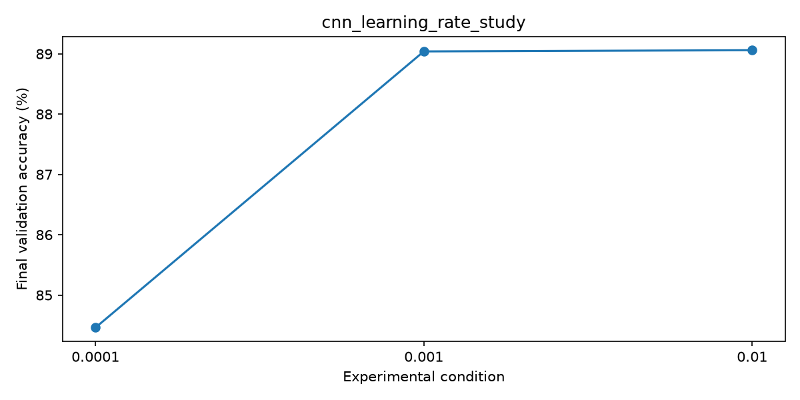
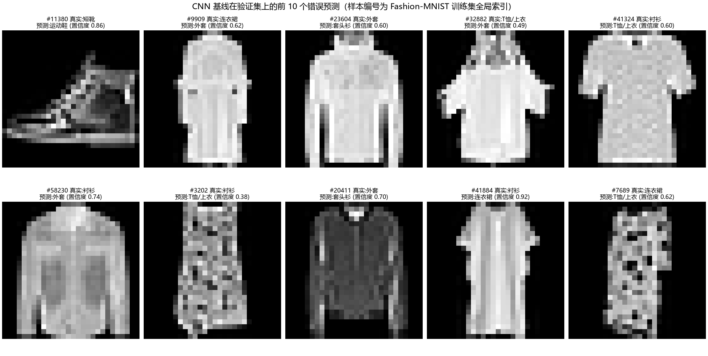
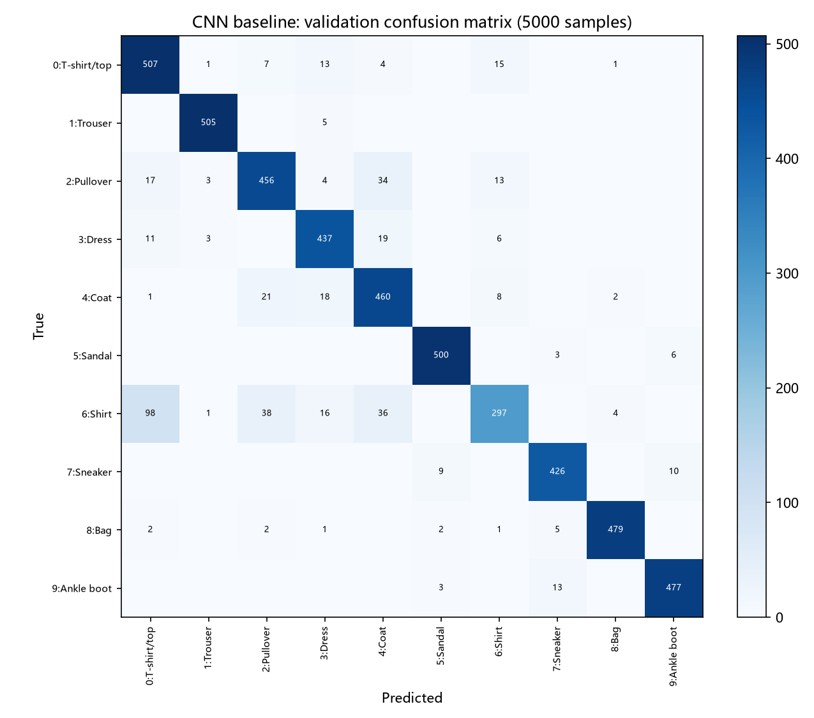

# AI-Lab Line2 第一阶段实验报告

姓名：李晨辉　　学号：2026009793

## 1. 基本信息

- 姓名/学号：李晨辉 / 2026009793
- 代码仓库或提交位置：本地提交包，`notebooks/` 是跑过的 notebook（带着输出），`results/` 是这次跑出来的指标和图表
- Python / PyTorch 版本：Python 3.12.10，PyTorch 2.15.0+cpu，torchvision 0.29.2+cpu
- 操作系统与设备：Windows 11，Intel i9-14900HX（24 核 32 线程），16G 内存，没有可用的 NVIDIA 显卡，全程 CPU
- 完成日期：2026-11-11

## 2. 项目目标与完成情况

项目要求从一个能跑的基线出发，理解 MLP 和 CNN 的训练流程，在相同条件下比较两个模型，从验证集里找错误样本分析，再自己设计一个至少三组的对照实验，最后整理成报告。

T1 到 T4 都做完了。两个基线都在本机跑通，训练曲线、逐轮指标和权重都存进了 `results/`。T1 我改的是学习率，1e-3 换成 3e-4，结果另存成 `mlp_lr_variant_0p0003`；T2 改的是卷积通道数，32/64 换成 16/32，另存成 `cnn_structure_variant`，两次都没覆盖基线。T3 做学习率对照，1e-4、1e-3、1e-2 三组各 3 轮，除学习率外其余设置完全一样。T4 等所有设置定下来才跑测试集，只跑了一次。

没有没完成的。这台机器没有显卡，训练都在 CPU 上跑，所以轮数还是项目默认的基线 5 轮、自主实验 3 轮，没有为了数字好看去加长。

## 3. 基线复现

### 3.1 MLP

结构是 Flatten 之后接 784→256→128→10 三个全连接层，中间 ReLU，输出 10 个 logits，没接 Softmax。参数量 235,146，是用 `sum(p.numel() for p in model.parameters())` 数出来的。

训练设置：batch 128，5 轮，Adam，学习率 1e-3，交叉熵，种子 42，不做数据增强。训练集 55,000，验证集 5,000。

第 5 轮训练损失 0.3058、训练准确率 88.76%，验证损失 0.3680、验证准确率 86.26%。5 轮里最好的验证准确率是 87.12%，出在第 4 轮。

| epoch | 训练损失 | 训练准确率 | 验证损失 | 验证准确率 |
| ---: | ---: | ---: | ---: | ---: |
| 1 | 0.5802 | 79.53% | 0.4479 | 84.20% |
| 2 | 0.3940 | 85.79% | 0.4065 | 85.28% |
| 3 | 0.3516 | 87.22% | 0.3874 | 85.84% |
| 4 | 0.3227 | 88.23% | 0.3632 | 87.12% |
| 5 | 0.3058 | 88.76% | 0.3680 | 86.26% |

训练损失一直在降，但第 5 轮验证损失比第 4 轮高了一点（0.3632→0.3680），验证准确率也从 87.12% 掉到 86.26%，训练准确率反而还在涨。我觉得这是过拟合的早期迹象，5 轮下来模型开始记训练集的细节了。

T1 的独立修改只动一个变量，学习率 1e-3 换成 3e-4：

| 运行 | 学习率 | 最终训练损失 | 训练准确率 | 最终验证损失 | 验证准确率 |
| --- | ---: | ---: | ---: | ---: | ---: |
| mlp_baseline | 1e-3 | 0.3058 | 88.76% | 0.3680 | 86.26% |
| mlp_lr_variant_0p0003 | 3e-4 | 0.3589 | 87.19% | 0.3809 | 86.82% |

验证准确率高 0.56 个百分点，训练准确率低 1.57 个百分点，验证损失高 0.0129。

我一开始的想法是：学习率小一点，每步走得短，5 轮内参数拟合不够，训练准确率应该会掉；验证集这边如果曲线更稳，可能反而略高。实际结果就是这样，变体的验证曲线是单调往上走的（84.20→86.82），没有基线末期那种回落，可能说明步长偏大到后期会在小损失附近来回跳。不过 0.56 个百分点、只跑一个种子，我没法说 3e-4 一定更好，只能讲这次预算下两个学习率差不多，3e-4 稳一点。

遇到的问题：一开始装 CPU 版 PyTorch 是按 README 用 download.pytorch.org 的源，pip 卡了十几分钟没动静，后来换成镜像源很快就装好了，最后是 torch 2.15.0+cpu。另外 `requirements.txt` 里没有 torch，得照 README 单独装，这个记在复现说明里了。正式训练前我先只跑 1 轮确认单轮耗时正常（MLP 大概五六秒一轮），再恢复 5 轮。

### 3.2 CNN

结构是两次「Conv2d(3×3, padding=1)+ReLU+MaxPool2」，第一层 1→32 通道，第二层 32→64，然后 Flatten 接 64×7×7→128 的全连接，输出 10 类。参数量 421,642。两次池化后特征图是 `[batch, 64, 7, 7]`。

训练设置和 MLP 一样：同一份划分、只做 ToTensor、batch 128、5 轮、Adam、1e-3、种子 42。

第 5 轮训练损失 0.2287、训练准确率 91.65%，验证损失 0.2539、验证准确率 90.88%，也是 5 轮里最好的。

| epoch | 训练损失 | 训练准确率 | 验证损失 | 验证准确率 |
| ---: | ---: | ---: | ---: | ---: |
| 1 | 0.5269 | 81.33% | 0.4214 | 84.98% |
| 2 | 0.3301 | 88.13% | 0.3432 | 87.24% |
| 3 | 0.2812 | 89.80% | 0.3053 | 89.06% |
| 4 | 0.2512 | 90.91% | 0.3036 | 88.82% |
| 5 | 0.2287 | 91.65% | 0.2539 | 90.88% |

第 4 到第 5 轮验证损失降得比较明显（0.3036→0.2539），验证准确率涨了两个点，没有 MLP 那种末期回落。

结构变体只改卷积通道数，32/64 换成 16/32，卷积核还是 3。参数量从 421,642 降到 206,922，差不多一半，减少的主要是分类头输入从 64×7×7 变成 32×7×7 这一块。结果训练损失 0.2686、训练准确率 90.24%，验证损失 0.2956、验证准确率 89.16%，比基线低 1.72 个百分点，验证损失高 0.0416。容量少确实有代价，但差距不算大，说明这个任务上 32/64 通道有点冗余。

| 运行 | 通道数 | 参数量 | 最终训练损失 | 训练准确率 | 最终验证损失 | 验证准确率 |
| --- | --- | ---: | ---: | ---: | ---: | ---: |
| cnn_baseline | 32/64 | 421,642 | 0.2287 | 91.65% | 0.2539 | 90.88% |
| cnn_structure_variant | 16/32 | 206,922 | 0.2686 | 90.24% | 0.2956 | 89.16% |

遇到的问题：画错误案例图时中文全变成方块，查了是 matplotlib 默认字体没有中文，在导入那段加了 Microsoft YaHei 和 `axes.unicode_minus=False` 就好了，改动写在 02 notebook 里。还有一次跑 03 直接报 `NameError: name 'CNN' is not defined`，查下来是模板里 03 调用了 `CNN()` 但没给类定义，是模板本身的问题，我在 03 里补了一段和 02 完全一样的 CNN 定义，其它超参数没动。

## 4. 模型对比

| 模型 | 数据划分 | 训练轮数 | 最终训练损失 | 最终验证损失 | 最终验证准确率 |
| --- | --- | ---: | ---: | ---: | ---: |
| MLP | 55000/5000，seed 42 | 5 | 0.3058 | 0.3680 | 86.26% |
| CNN | 55000/5000，seed 42 | 5 | 0.2287 | 0.2539 | 90.88% |

比较条件我核对过：两边用同一个 random_split（generator seed 42）、同样只做 ToTensor、batch 128、5 轮、Adam 1e-3、同一个损失函数和种子，真正不同的只有模型结构，这正好是要比的东西。

CNN 验证准确率高 4.62 个百分点，验证损失低 0.1141。不过 CNN 参数量是 MLP 的 1.79 倍，所以不能简单说成“CNN 更强”，更准确的说法是在这套数据、这个预算下，卷积结构更适合图像，学到的特征更能迁移到没见过的样本上。





## 5. 自主实验设计

研究问题：数据划分、模型结构、batch size、优化器、训练轮数（3 轮）和随机种子都不变，只把学习率取 1e-4、1e-3、1e-2 时，CNN 前三轮的收敛过程和对验证集的表现有什么区别？

假设：3 轮预算不长，我猜 1e-3 会比较合适；1e-4 太小，3 轮内学得不够，验证指标应该最差；1e-2 前期损失掉得快，但可能震荡，最后不一定最好。

自变量：学习率，1e-4 / 1e-3 / 1e-2，三个值差不多差一个数量级。

看什么：每轮的训练损失、验证损失和两边准确率，重点看第 3 轮结束时的验证损失和验证准确率，还有前 3 轮验证损失下降的快慢。

控制变量：划分（55000/5000，seed 42）、3 轮、batch 128、Adam、`CNN(32,64,k=3)`、种子 42、不做数据增强。

为什么这么设计：学习率是训练里最常调、影响最直接的超参，改它只要一行，其它条件天然就能保持一致；三个值差一个数量级，趋势应该看得出来。

可能干扰结果的因素：只跑一个种子，初始化和数据顺序的随机性都在里面；只训 3 轮，反映的是短预算下的收敛，不代表训练充分之后的样子；每组都重新建模型和 DataLoader，但种子相同所以数据顺序一致；CPU 上算子实现差异可能带来很小的数值差别。另外不同学习率在同样轮数里“走的步数”不一样，我比的是同样轮数下的表现，不是收敛到同样程度需要多少步。

03 模板的问题前面提过：调用了没定义的 `CNN()`，独立跑会报错。我补了跟 02 一样的结构，并在单元格上面写了说明，这样三组实验的结构才一致。

## 6. 自主实验结果

| 条件 | 学习率 | 第 3 轮训练损失 | 训练准确率 | 第 3 轮验证损失 | 验证准确率 |
| --- | ---: | ---: | ---: | ---: | ---: |
| A | 1e-4 | 0.4546 | 83.86% | 0.4458 | 84.46% |
| B | 1e-3 | 0.2809 | 89.74% | 0.3032 | 89.04% |
| C | 1e-2 | 0.2668 | 90.07% | 0.3201 | 89.06% |

逐轮的验证指标：

| 条件 | 第 1 轮 损失/准确率 | 第 2 轮 | 第 3 轮 |
| --- | --- | --- | --- |
| A（1e-4） | 0.5963 / 78.04% | 0.5167 / 80.46% | 0.4458 / 84.46% |
| B（1e-3） | 0.4053 / 85.40% | 0.3388 / 87.60% | 0.3032 / 89.04% |
| C（1e-2） | 0.3529 / 87.62% | 0.3406 / 87.66% | 0.3201 / 89.06% |





数据来自 `results/cnn_learning_rate_study_summary.csv` 和三份 `_history.csv`，是 03 真跑出来的，没有手填。

## 7. 结果分析和假设检查

先说最明显的：学习率从 1e-4 提到 1e-3，验证准确率一下多了 4.58 个百分点（84.46%→89.04%），验证损失从 0.4458 掉到 0.3032。再从 1e-3 提到 1e-2，准确率只从 89.04% 变成 89.06%，差 0.02 个百分点，基本算噪声；验证损失反而从 0.3032 升到 0.3201。另外 1e-2 第 1 轮就到了 87.62% 验证准确率，1e-3 才 85.40%，说明大学习率前期确实快，但 3 轮下来没换成更好的精度。

假设对了一半。1e-4 确实是三组最差的，验证损失 0.4458 也最高，和“步子太小、3 轮没学够”一致；1e-2 前期最快但最后验证损失不是最低，也符合“未必最好”。但我原先觉得 1e-3 会明显更合适，实际它和 1e-2 的准确率基本一样，只有验证损失低一点（0.3032 对 0.3201），这点差距单种子下说明不了太多。所以靠谱的说法是：3 轮预算里 1e-3 和 1e-2 表现接近，1e-3 损失略低，1e-4 明显不够。

有两处我特意留神了。第一是 1e-2 的验证准确率比 1e-3 高一点点，验证损失却更高，准确率只看 argmax 对不对，损失还管模型对正确类的置信度，损失高说明它给某些样本的置信度更极端，有些错得很自信，这两个指标方向不一致不矛盾，但只看准确率可能会误判。第二是三组都没出现验证损失明显回升的过拟合现象，这是 3 轮太短，不能说这几个学习率都不会过拟合。

设计上的限制：只跑一个种子，方差多大不知道，小差别没法判断；只训 3 轮，可能还在“没学完”的阶段；只试了一个模型结构和一份数据，学习率的最优值本来就和模型、优化器、batch 有关；每组只报了最终指标和验证曲线，没统计训练末期的波动；CPU、单精度实现也可能带来很小的数值差异。

如果接着做，我会先做多种子重复：1e-3 和 1e-2 各跑 3 到 5 个种子、训到 10 轮，报均值和标准差，这样能回答这两个学习率到底有没有差别，也能看 1e-2 的震荡会不会随训练放大。然后可以试试学习率和 batch size 的联合对照，这两个对实际步长的作用是耦合的。

## 8. 验证集错误案例分析

下面 10 个都来自验证集（5,000 张，seed 42），样本编号用的是 Fashion-MNIST 训练集的全局下标，方便回原数据里找，`val_position` 和 `dataset_index` 的对应关系记在 `results/cnn_validation_error_cases.csv` 里。没有从测试集挑案例，也没拿这些案例回头调模型。

| 全局编号 | 真实类别 | 预测类别 | 置信度 |
| ---: | --- | --- | ---: |
| 11380 | Ankle boot（短靴） | Sneaker（运动鞋） | 0.86 |
| 9909 | Dress（连衣裙） | Coat（外套） | 0.62 |
| 23604 | Coat（外套） | Pullover（套头衫） | 0.60 |
| 32882 | T-shirt/top（T恤） | Coat（外套） | 0.49 |
| 41324 | Shirt（衬衫） | T-shirt/top（T恤） | 0.60 |
| 58230 | Shirt（衬衫） | Coat（外套） | 0.74 |
| 3202 | Shirt（衬衫） | T-shirt/top（T恤） | 0.38 |
| 20411 | Coat（外套） | Pullover（套头衫） | 0.70 |
| 41884 | Shirt（衬衫） | Dress（连衣裙） | 0.92 |
| 7689 | Dress（连衣裙） | T-shirt/top（T恤） | 0.62 |



数据里能直接看到的：10 个里真实类别是 Shirt 的 4 个、Coat 2 个、Dress 2 个、T-shirt 1 个、Ankle boot 1 个，错的方向基本都在“上装”这一堆里，或者鞋类内部，没有上装认成鞋这种跨大类的错。全部 5,000 个验证样本的混淆矩阵也是这个规律：Shirt 被认成 T-shirt/top 98 次（占 Shirt 的 20.0%），Shirt 认成 Pullover 38 次（7.8%），Shirt 认成 Coat 36 次（7.4%），Pullover 认成 Coat 34 次（6.5%），Coat 认成 Pullover 21 次（4.1%），鞋里最大的是 Ankle boot 认成 Sneaker 13 次（2.6%）。



我猜的原因是（没做实验验证）：这几类衣服在 28×28 灰度图上轮廓本来就接近，区别主要在领口、袖子、下摆这些细节，而两次 2×2 池化后特征图只剩 7×7，细节丢得比较多，所以容易混；靴子和运动鞋也类似，都是低帮鞋，主要靠鞋口和鞋底区分。要确认这个解释得看特征图或者做遮挡实验，这次没做。

还有个现象：有些错得很自信，比如 41884 的 Shirt 被判成 Dress，置信度 0.92；11380 的短靴判成运动鞋，0.86。用置信度阈值筛错误不太靠谱。

各类别准确率（CNN 基线）差别很大：Trouser 99.02%、Sandal 98.23%、Bag 97.36%、Ankle boot 96.75%、Sneaker 95.73%、T-shirt/top 92.52%、Dress 91.81%、Coat 90.20%、Pullover 86.53%，Shirt 只有 60.61%。MLP 基线也是 Shirt 最差（65.31%），说明是这几类本身边界模糊，不是 CNN 特有的问题。

## 9. 结论和局限

能站得住的结论：

相同数据划分和训练预算下（5 轮、Adam 1e-3、batch 128、seed 42），小 CNN 的验证集比 MLP 好不少，90.88% 对 86.26%，验证损失 0.2539 对 0.3680；测试集也是 90.75% 对 86.27%，方向一致。

卷积通道减半（32/64→16/32，参数量约 49.1%）之后验证准确率掉到 89.16%，容量减少是有代价的，但小模型也能到接近基线的水平。

学习率实验里 1e-4 明显不如 1e-3 和 1e-2，1e-3 和 1e-2 最终准确率基本持平，1e-3 验证损失略低。这个结论只适用于这次的模型、数据划分和 3 轮预算，而且只有一个种子，不能推广成“1e-3 最好”。

验证集的错误集中在 Shirt/T-shirt/Pullover/Coat/Dress 这一堆上装内部，以及短靴和运动鞋之间，这和图本身相似、下采样后细节少有关，但这是推测。

验证集和测试集差得很少（MLP 86.26→86.27，CNN 90.88→90.75），说明没对着测试集调参，评估流程可靠。

局限：自主实验一个种子、3 轮，数据集和模型都小，没做数据增强、正则化、batch size 的联合实验，错误原因的推测也没验证。上面每条都只能限定在这次的设置里说。

## 10. 复现说明

执行顺序：00 环境检查 → 01 MLP 基线 → 02 CNN 基线 → 03 自主实验 → 04 最终测试，每个 notebook 用独立内核从头跑一次。路径以项目根目录为准，`data/` 和 `results/` 会自动建。本机全部顺序跑完大约 6 分钟（00 4 秒、01 70 秒、02 157 秒、03 134 秒、04 7 秒），不算第一次下 Fashion-MNIST 的 15 秒左右。

依赖安装（CPU）：

```powershell
python -m venv .venv
.\.venv\Scripts\Activate.ps1
python -m pip install --upgrade pip
python -m pip install torch torchvision
python -m pip install -r requirements.txt
```

我装出来是 torch 2.15.0+cpu、torchvision 0.29.2+cpu。README 里给的官方 CPU 源我这边下不动，换了镜像。如果有 GPU，按官方选择器装匹配 CUDA 的版本，再用 `requirements.txt` 补其它依赖，别用 CPU 版盖掉。

数据：`torchvision.datasets.FashionMNIST(root="data", download=True)`，官方训练集 60,000、测试集 10,000，第一次运行自动下载。

种子：全局 `SEED=42`，random、numpy、torch 都设了；划分用 `random_split(..., generator=torch.Generator().manual_seed(42))`。

输出：都在 `results/`。每次训练有 `*_history.csv`（逐轮）、`*_metrics.json`（最终指标）、`*_state_dict.pt`（权重），曲线是 `*_curves.png`；模型对比、错误案例、混淆矩阵、各类别准确率、学习率实验汇总、测试结果也在里面，文件名见 README。

已知问题：03 模板缺 CNN 定义（已补）；中文图表要系统里有 Microsoft YaHei 或 SimHei；CPU 上 MLP 大概 5 秒一轮、CNN 大概 15–18 秒一轮，换机器耗时会变，固定种子下指标应该差不多，CPU 算子差异可能带来末位抖动；`results/` 里的 `.pt` 每个不到 2 MB，只是留档，删掉不影响报告里的任何数字。

## 11. AI 工具使用说明

这次用了 DeepSeek Harness 里的对话式 AI 编程助手。用得最多的三块：装环境的时候 pip 一直下不动，它提示换镜像源；matplotlib 中文显示成方块，它给了字体设置；03 模板少一个 CNN 类定义，也是它指出来后补上的。另外验证集错误分析的后处理脚本（错误案例、混淆矩阵、各类别准确率）和报告的文字初稿，它帮了忙。

模型结构、数据划分、超参数和三组学习率都是项目包原来的要求，没让它改。

报告里的数字都来自本机实际运行，能在 `results/` 下的 csv/json 里一个个对上（比如 CNN 验证准确率 90.88% 在 `cnn_baseline_metrics.json` 里）。AI 给的代码也都在本机跑通过才留在 notebook 里，03 是补完定义之后重新完整执行了一遍。答辩前我还会把附录 A 那几道题对着代码再过一遍。

## 12. 提交前自检

- [x] MLP 和 CNN 基线都能跑（01、02 已执行，输出保留）
- [x] 实验配置、日志、曲线都存了（`results/`）
- [x] 自主实验三组以上条件（1e-4 / 1e-3 / 1e-2，其它条件一致）
- [x] 报告里的数和代码输出对得上
- [x] 错误案例来自验证集，测试集只跑了一次
- [x] 能解释主要代码、实验设计和结论（附录 A）
- [x] 说明了 AI 工具使用情况（第 11 节，另见 `AI使用说明.md`）

## 附录 A：思考题

### 01 MLP

**1. 为什么输出 10 个 logits，不直接输出类别编号？**
类别编号是离散的，argmax 不可导，没法反向传播。10 个 logits 是连续分数，交叉熵能用“正确类分数比别的类高多少”算出一个可导的损失，梯度才能传回去。推理时对 10 个分数做 softmax 也方便看置信度。

**2. `loss.backward()` 和 `optimizer.step()` 各做什么？**
`backward()` 沿计算图反着算一遍，把损失对每个参数的梯度算出来存在 `param.grad`；`step()` 按优化器的规则拿这些梯度更新参数。顺序不能反，而且每轮开头要 `zero_grad()`，不然梯度会一直累加。

**3. 训练准确率一直涨、验证准确率不动说明什么？**
模型在往记住训练集的方向走，泛化没变好，往往是过拟合的前兆，验证损失一般也开始不降了。这次 MLP 第 5 轮就有点这个意思。能试的办法有早停、加正则、数据增强、加数据。

**4. 为什么不能只看训练集指标？**
训练集是模型见过的数据，可以通过记忆把数字刷得很高，会系统性高估真实水平（这次 MLP 训练 88.76%、验证 86.26%，CNN 训练 91.65%、验证 90.88%，都能看出来）。而且拿同一批数据反复调参，调出来的结果只对这批数据好。

### 02 CNN

**1. 卷积输入为什么有通道这个维度？**
图像本身就有通道（灰度 1 个、RGB 3 个），每个通道都要单独和卷积核做运算再求和；网络中间层的通道数是上一层输出的特征图个数，代表不同的滤波器。`Conv2d` 的第一个参数就是输入通道数。

**2. `channels_2 * 7 * 7` 怎么来的？**
输入 28×28，两次 `MaxPool2d(2)` 后变成 14×14、再变成 7×7，第二层卷积输出 `channels_2` 个 7×7 特征图，Flatten 就是 `channels_2×7×7` 个数，这次是 64×7×7=3136。

**3. 局部连接和权重共享是什么意思？**
局部连接是每个输出只和输入的一小块（感受野）相连，不是和整张图相连，参数少，也符合图像局部相关的特点；权重共享是同一个卷积核滑到整张图所有位置都用同一组参数，参数数量不随图片大小变，同一个特征在哪个位置出现都会被同样检测到。

**4. 为什么 CNN 不是每次都一定比 MLP 好？**
CNN 的假设更适合图像，但需要训练够、结构合适、超参合适；预算很小、只跑一次时，初始化、数据顺序这些随机性可能把差距盖掉。另外两者参数量、计算量本来就不一样，比的时候要说清楚。这次 5 轮预算下 CNN 的验证集更好（90.88% 对 86.26%），但也只有一个种子。

**5. 比较模型为什么要控制数据划分和训练设置？**
不控制的话，看到的差别可能是数据量、顺序、batch size、轮数、优化器、学习率或者种子造成的，不是模型结构造成的，实验就没说服力了。这次对照表里我把这些条件逐条对过，只让结构变。

### 03 自主实验

- 研究问题能回答：三组只改学习率，指标直接对应 3 轮内的收敛和最终验证表现。
- 三组都真跑了：`results/cnn_learning_rate_study_*` 里有完整的逐轮指标和权重。
- 假设没完全成立，我按实际结果写了“对了一半”，没有硬凑。
- 局限写在第 5、7、9 节：单种子、3 轮、一个数据集。
- 测试集没参与挑模型，只在 04 里跑了一次。
