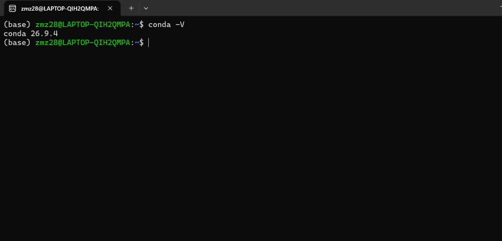
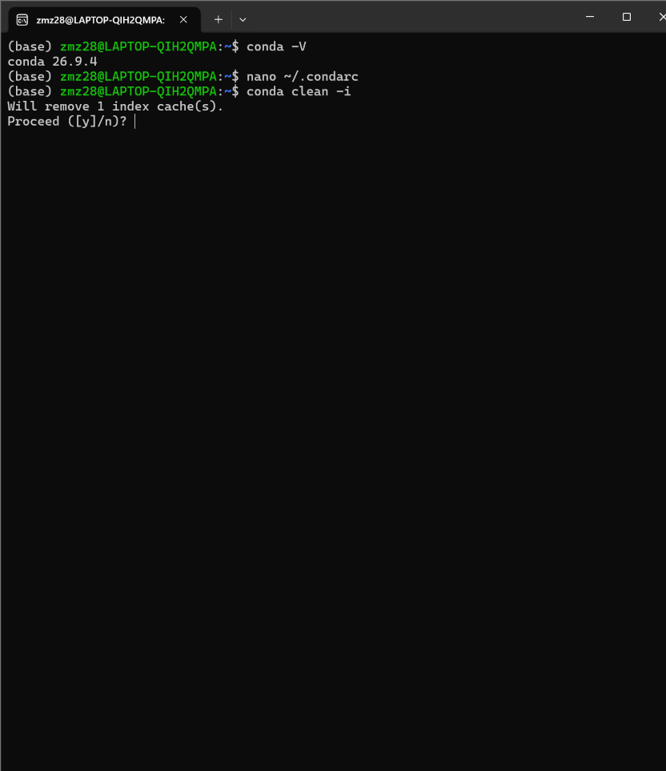
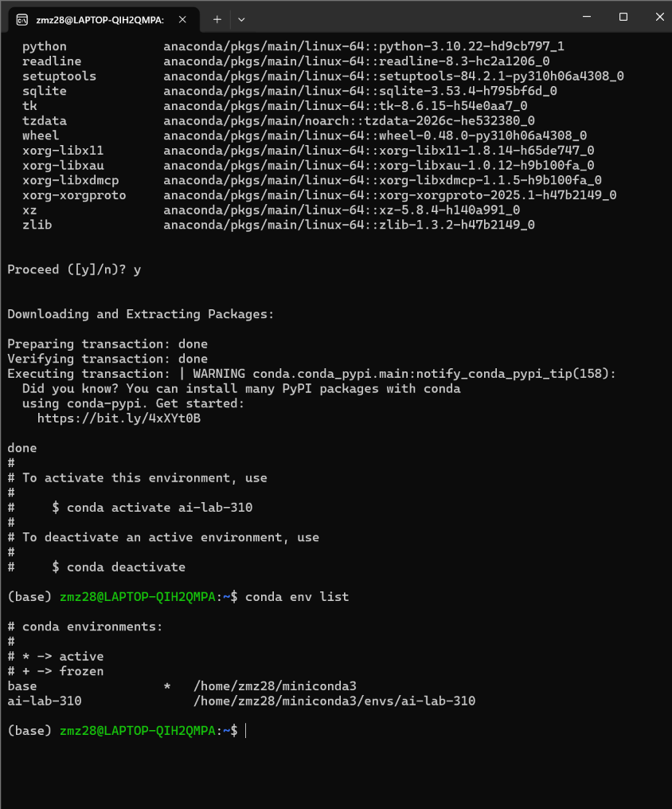
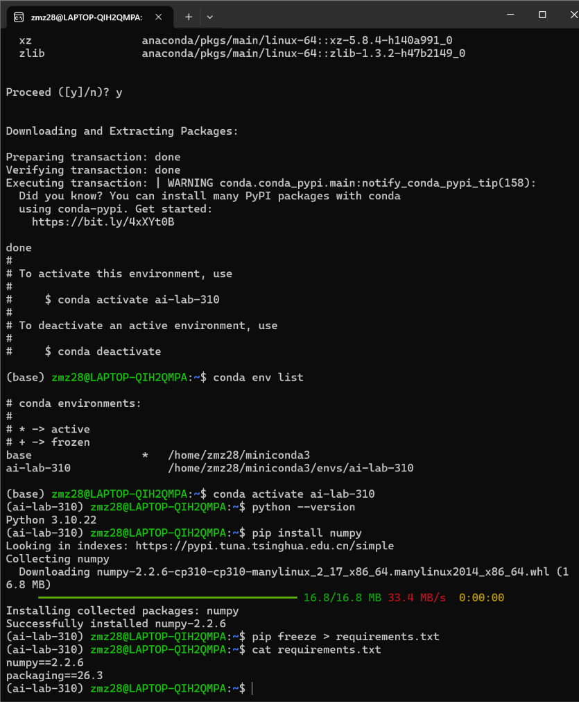
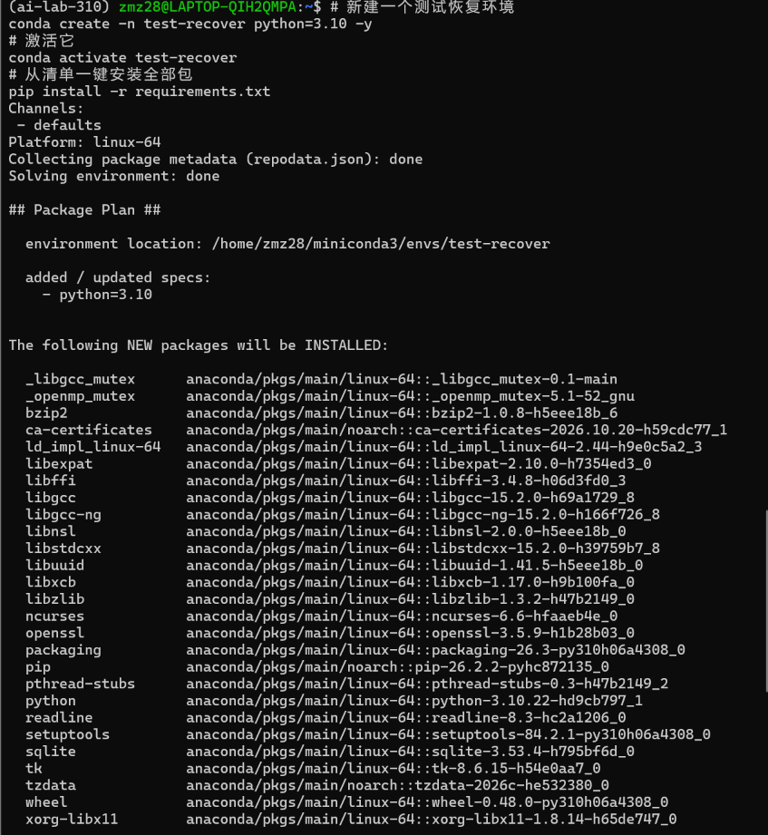
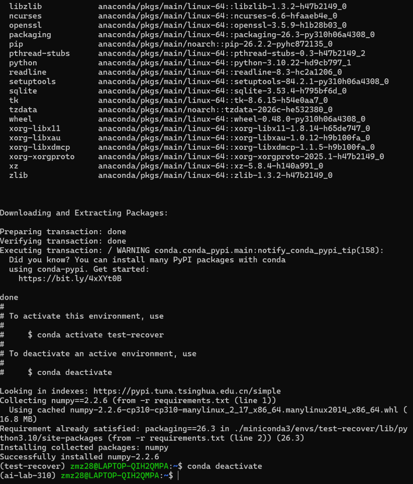

 [task05.md](https://github.com/user-attachments/files/34580156/task05.md)
# Task05 Conda 虚拟环境搭建实验报告

## 实验目的

1. 掌握 Miniconda 的安装方法，理解 conda 包管理器作用
2. 配置 conda 清华镜像源，加速包下载
3. 理解**虚拟环境隔离思想**：不同项目的 Python 版本、依赖包互不干扰，避免版本冲突
4. 掌握虚拟环境创建、激活、查看、退出操作
5. 掌握依赖清单`requirements.txt`导出与环境复现方法

## 实验环境

- 操作系统：WSL2 Ubuntu
- 工具：Miniconda3
- 实验用户：zmz28

## 实验原理

Conda 是跨平台的包和环境管理工具。虚拟环境本质是独立的文件夹，内置一套独立 Python 解释器与依赖库。

- `conda`：管理 Python 版本、conda 生态包
- `pip`：Python 官方包管理工具，管理 PyPI 上的第三方库
- `requirements.txt`：Python 项目标准依赖文件，记录所有包及精确版本，用于环境迁移、复现

## 实验步骤（带命令 + 解释）

### 1. Miniconda 安装

```bash
wget -c https://repo.anaconda.com/miniconda/Miniconda3-latest-Linux-x86_64.sh
```

> wget：下载工具；`-c`断点续传，网络中断后可以接着下载

```bash
bash Miniconda3-latest-Linux-x86_64.sh
```

> bash 执行安装脚本，按照提示：回车阅读协议 → 输入`yes`同意协议 → 回车确认安装路径 → **最后一步输入 yes 初始化 conda**
>
> 安装完成后**关闭并重开终端**，提示符出现`(base)`代表 base 环境加载成功

验证安装

```bash
conda -V
```

> 输出 conda 版本号，代表安装成功

### 2. 配置 conda 清华镜像源

```bash
nano ~/.condarc
```

> nano 是文本编辑器；`~/.condarc`是 conda 的配置文件，默认不存在，打开即新建

```yaml
channels:
  - defaults
show_channel_urls: true
default_channels:
  - https://mirrors.tuna.tsinghua.edu.cn/anaconda/pkgs/main
  - https://mirrors.tuna.tsinghua.edu.cn/anaconda/pkgs/r
custom_channels:
  conda-forge: https://mirrors.tuna.tsinghua.edu.cn/anaconda/cloud
```

保存退出：`Ctrl+X` → `Y` → 回车

```bash
conda clean -i
```

> `-i`：清理旧索引缓存，让新镜像源配置生效

### 3. 配置 pip 清华镜像

```bash
pip config set global.index-url https://pypi.tuna.tsinghua.edu.cn/simple
```

> 修改 pip 全局下载源，后续 pip 安装包走清华镜像，提升下载速度

### 4. 创建指定版本虚拟环境

```bash
conda create -n ai-lab-310 python=3.10
```

- `create`：新建环境
- `-n ai-lab-310`：`-n`指定环境名称
- `python=3.10`：指定环境内 Python 版本为 3.10

> 出现`Proceed ([y]/n)?`输入`y`确认安装依赖

### 5. 查看所有虚拟环境

```bash
conda env list
```

> 列出本机全部 conda 环境，`*`标记当前正在使用的环境

### 6. 激活虚拟环境

```bash
conda activate ai-lab-310
```

> 激活后提示符前缀从`(base)`变为`(ai-lab-310)`，之后所有 python、pip 操作都在这个隔离环境中
>
> 验证 Python 版本

```bash
python --version
```

### 7. 安装测试依赖包

```bash
pip install numpy
```

> 在当前环境安装 numpy 科学计算库，用来演示依赖导出

### 8. 导出依赖清单 requirements.txt

```bash
pip freeze > requirements.txt
```

- `pip freeze`：扫描当前环境，输出所有包 + 版本

- ```
  >
  ```

  重定向，把屏幕输出写入文件，而不是打印到终端

  **查看文件内容：**

```bash
cat requirements.txt
```

> cat：读取文本文件，打印内容到终端，确认依赖清单生成成功

### 9. 环境复现（拓展演示）

```bash
# 创建新测试环境
conda create -n test-recover python=3.10 -y
# 激活环境
conda activate test-recover
# 从依赖清单一键安装所有包
pip install -r requirements.txt
```

> `-r`读取 requirements.txt，批量安装清单内所有依赖，实现环境迁移

### 10. 退出虚拟环境

```bash
conda deactivate
```

> 退出当前环境，回到 base 基础环境

## 实验结果

1. Miniconda 安装成功，`conda -V`正常输出版本
2. conda、pip 镜像源配置完成，国内下载加速
3. 成功创建`ai-lab-310`环境，Python 版本 3.10
4. 成功导出`requirements.txt`，可用于跨设备复现环境

## 实验思考

1. 为什么要用虚拟环境？

> 不同项目依赖包版本要求不一样，虚拟环境隔离依赖，防止包版本冲突，项目之间互不影响。

1. base 环境是什么？

> base 是 conda 自带的基础环境，尽量不要在 base 里装大量项目依赖，保持干净。

1. conda 源和 pip 源的区别？

conda 源负责 conda 命令安装包；pip 源负责 pip 安装 PyPI 包，两者需要分别配置

# conda -V 验证



# condarc 配置文件

# 

# conda env list 环境列表



# activate 激活后提示符 + python --version

# pip freeze + cat requirements.txt






