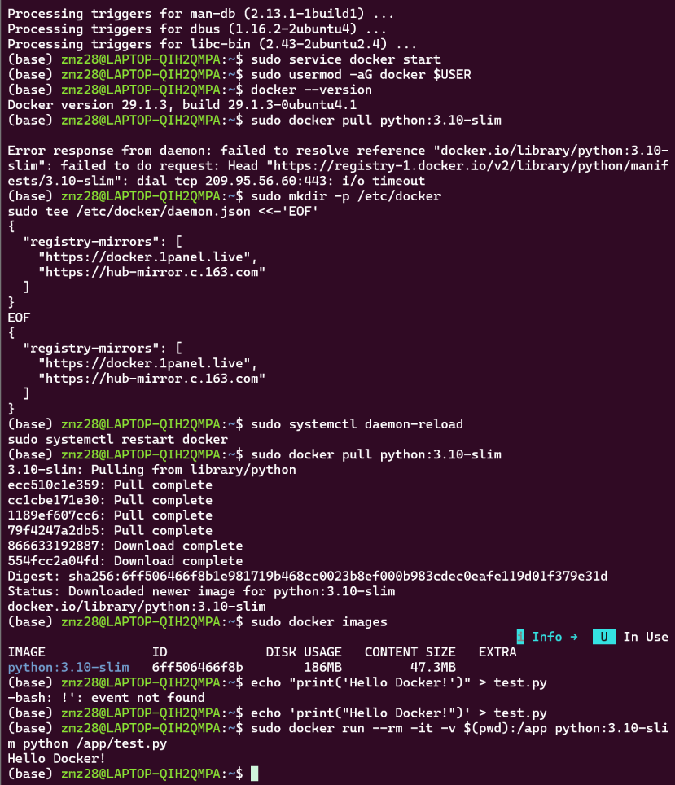
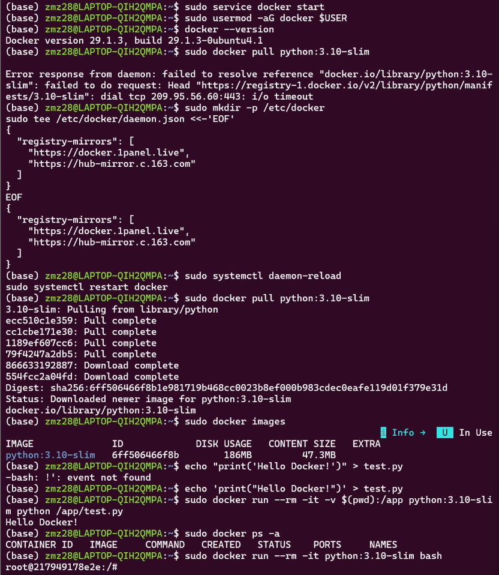
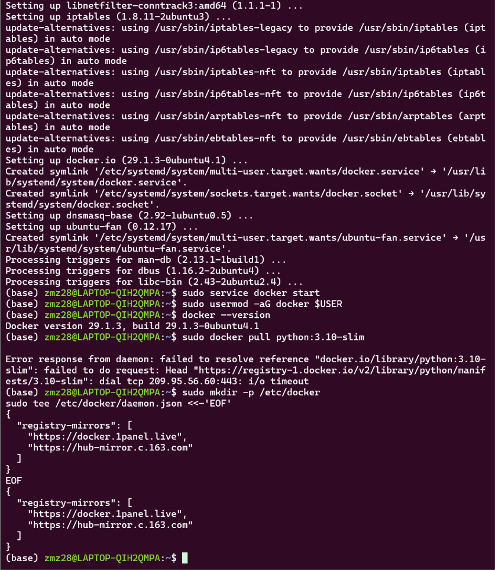
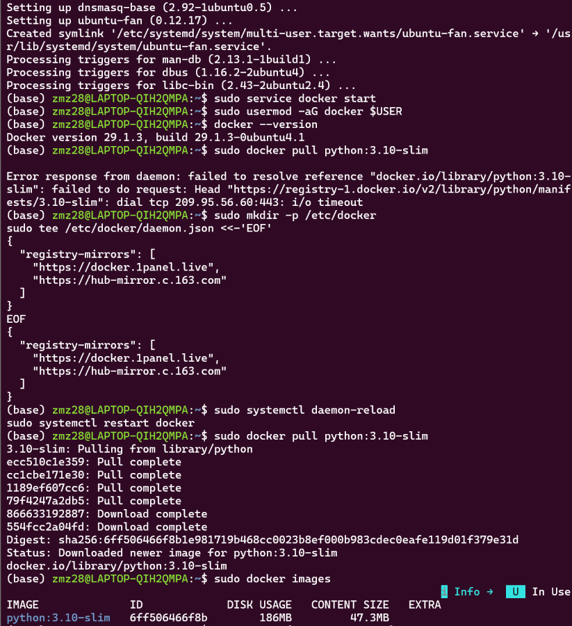
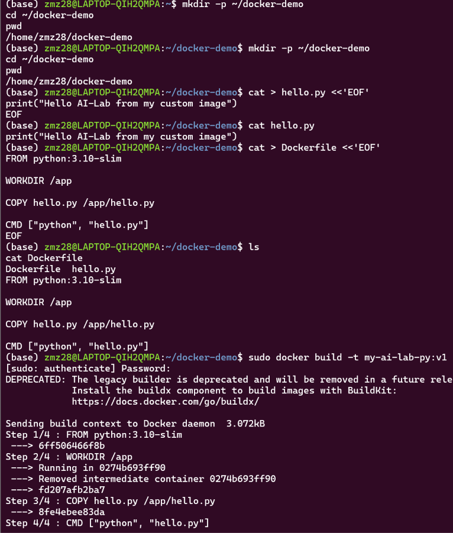
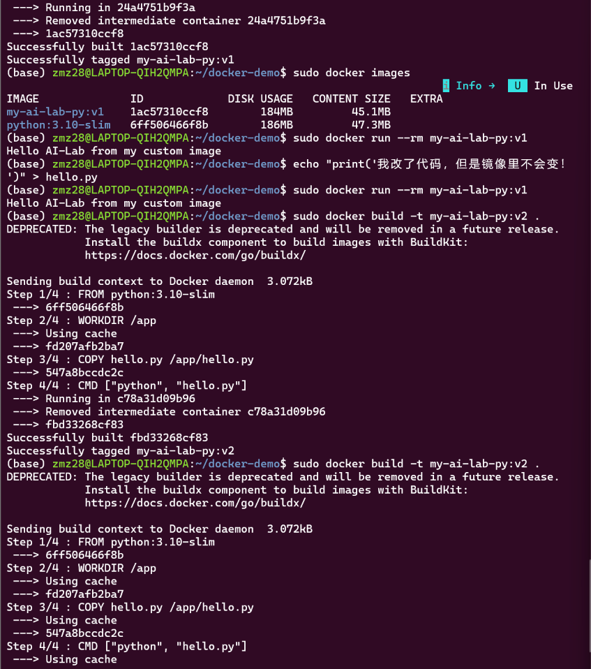
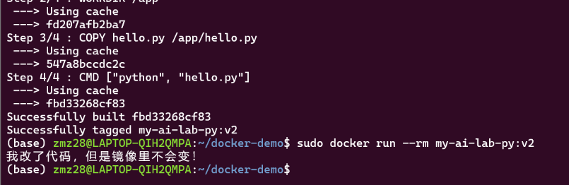

# Task06 Docker 容器初探 —— 实验记录

> 作者：赵铭哲（大一 · 软件工程 · AI-Lab 通识任务）
> 环境：Windows + WSL2（Ubuntu），终端里带着 conda 的 `(base)` 前缀跑完整个过程
> 一句话总结：用一个装好 Python 的 Docker 小盒子，直接跑我电脑上写好的 py 文件，靠挂载实现文件互通，不用把代码塞进盒子里。

---

## 一、先把我搞混的三个概念摆清楚

刚开始我一直分不清镜像、容器、挂载，后来用外卖打包盒类比才算真明白：

| 概念 | 类比 | 到底是什么 | 本次对应的东西 |
|---|---|---|---|
| 镜像 Image | 工厂做好的标准打包盒模板 | 只读、静态，存在硬盘里，不跑 | `python:3.10-slim` |
| 容器 Container | 拿模板现场装出来的一份外卖 | 镜像跑起来的实例，活的、可读写 | `docker run` 出来的那个东西 |
| 挂载 -v | 盒子侧面开了个口子，直连我的桌面 | 宿主机目录 ↔ 容器目录，双向同步 | `$(pwd)` ↔ `/app` |

记住两个要点：
1. 镜像 = 模具，容器 = 模具压出来的成品，一个模具能压无数个成品。
2. 容器默认是**密封**的，看不到我 Ubuntu 里的文件；挂载就是专门开的那个口子。

---

## 二、整体流程（我实际跑下来的顺序）

```
① 启动 docker 服务
        ↓
② 配国内镜像加速（不配就拉不动）
        ↓
③ docker pull python:3.10-slim     ← 拿到"模具"
        ↓
④ 在 Ubuntu 里写 test.py           ← 代码放宿主机上
        ↓
⑤ docker run --rm -it -v $(pwd):/app python:3.10-slim python /app/test.py
        ↓
   输出 Hello Docker!  容器读到宿主机的文件并执行
        ↓
⑥ 容器退出，--rm 自动销毁；但 test.py 还在我 Ubuntu 里
```

---

## 三、一步步怎么做（附我踩的坑）

### 步骤 1：装 Docker、起服务

```bash
sudo apt update                       # 刷新软件清单，用清华源，很快
sudo apt install docker.io -y         # 装 docker 社区版，-y 自动确认
sudo service docker start             # 启动后台守护进程 dockerd
sudo usermod -aG docker $USER         # 把我加进 docker 组，以后免 sudo
docker --version                      # 验证：Docker version 29.1.3
```

我的理解：
- Docker 是 C/S 架构，前端 `docker` 命令 + 后台 `dockerd` 服务。**服务不起，所有 docker 命令都报错**。
- `apt update` 只刷新清单，不装东西。
- `usermod -aG` 要**重开终端**才生效，所以我在当前会话里还是乖乖加 `sudo`。

> 踩坑点：`docker --version` 正常，但下一句 `docker pull` 出现 `permission denied` 才说明组权限没生效——重新开一个 WSL 终端就好。

### 步骤 2：配国内镜像加速 

第一次直接 `sudo docker pull python:3.10-slim` 直接卡住然后超时，报的错大概是：

```
Error response from daemon: Get "https://registry-1.docker.io/v2/":
dial tcp ... i/o timeout
```

原因：默认去国外 Docker Hub 拉，国内网络不稳。解决办法是给 Docker 加中转站：

```bash
sudo mkdir -p /etc/docker
sudo tee /etc/docker/daemon.json <<-'EOF'
{
  "registry-mirrors": [
    "https://docker.1panel.live",
    "https://hub-mirror.c.163.com"
  ]
}
EOF
sudo systemctl daemon-reload
sudo systemctl restart docker
```

我的理解：
- `/etc/docker/daemon.json` 是 Docker 守护进程的配置文件，`registry-mirrors` 就是镜像加速地址列表。
- 改完必须 `daemon-reload` + `restart docker` 才生效，光写文件没用。
- `<<-'EOF' ... EOF` 是 heredoc，一次性把多行内容塞进文件，比进 nano 手敲省事。

> 如果哪天这个加速地址也挂了，可以换一个能用的镜像站，或者直接用带域名的镜像地址拉，比如 `docker.1panel.live/library/python:3.10-slim`。

### 步骤 3：拉镜像、看本地有什么

```bash
sudo docker pull python:3.10-slim
sudo docker images
```

- `pull` = 从公共仓库下载镜像到本地。
- `python` 是官方镜像名，`3.10-slim` 是 tag：
  - `3.10` 指定里面是 Python 3.10，跟我 Task05 的 conda 环境版本对齐，方便对照；
  - `slim` 是精简版，砍掉了 gcc 之类的系统工具，体积小、下载快，做实验够用。
- `docker images` 能看到 IMAGE / TAG / IMAGE ID / SIZE 四列，确认镜像真的躺在本地了。

### 步骤 4：在宿主机写测试脚本

```bash
echo 'print("Hello Docker!")' > test.py
```

> 踩坑点：我一开始写的是双引号包 `"Hello Docker!"`，bash 直接甩了一句
> `-bash: !": event not found`
> 因为 `!` 在 bash 里是历史命令展开符号。换成**单引号**包住整段就没事了（或者 `set +H` 关掉历史展开）。
> 顺便记住：`>` 是重定向，把输出写进文件；`>>` 是追加。

### 步骤 5：核心命令 —— 挂载运行

```bash
sudo docker run --rm -it -v $(pwd):/app python:3.10-slim python /app/test.py
```

逐参数拆开（这条是本次实验的考点，必须能讲明白）：

| 参数 | 全称 | 作用 | 为什么这么写 |
|---|---|---|---|
| `run` | — | 用镜像创建**并**启动一个容器 | 一步到位，不用先 create 再 start |
| `--rm` | — | 容器退出后自动删除容器 | 练习用的临时容器，不清理会堆一堆僵尸容器 |
| `-it` | `--interactive --tty` | 保持输入通道 + 分配伪终端 | 能交互、能看到输出；只跑脚本其实 `-t` 就够，加 `-i` 是标准写法 |
| `-v $(pwd):/app` | `--volume` | 宿主机当前目录挂到容器 `/app` | **本次核心**，代码不进镜像也能被容器读到 |
| `$(pwd)` | — | shell 取当前目录绝对路径 | 等价于我手动敲 `/home/zmz28/xxx`；PowerShell 是 `${PWD}`，CMD 是 `%cd%` |
| `python:3.10-slim` | — | 指定用哪个镜像起容器 | 必须写全 `名字:tag`，不写 tag 默认 `latest` |
| `python /app/test.py` | — | 容器启动后执行的命令 | 容器里执行的是 `/app/test.py`，而 `/app` 就是挂载进来的我的目录 |

**为什么挂载这么重要**（我的理解）：
1. 不加挂载，代码只能靠 `COPY` 打进镜像里，改一行代码就得重新 `build` 一次镜像；
2. 加了 `-v`，宿主机改 `test.py`，容器里立刻看到新版本，**直接再 run 一次就能跑新代码**，开发调试爽得多；
3. 代码文件保存在宿主机上，容器删了文件还在，不会因为 `--rm` 丢东西；
4. 双向同步：容器里往 `/app` 写文件，我 Ubuntu 这边也会出现。

运行结果：

```
Hello Docker!
```

容器成功读到了宿主机上的 `test.py`，并且用镜像里的 Python 3.10 执行了它。

### 步骤 6：顺手检查一下容器状态

```bash
sudo docker ps -a
```

- `ps` 默认只看**正在运行**的容器；
- `-a` = all，看运行中 + 已停止的；
- 因为命令带了 `--rm`，跑完容器就被删了，这里查不到它，正常现象。

---

## 四、几个命令之间的区别（容易混的）

| 命令 | 管什么 | 记忆点 |
|---|---|---|
| `docker images` | 本地**镜像**列表 | image → 模具 |
| `docker ps -a` | 本地**容器**列表 | container → 成品 |
| `docker pull` | 下载镜像 | 从仓库往下拉 |
| `docker run` | 镜像 → 容器并启动 | 模具压成品 |
| `docker start/stop` | 启停已存在的容器 | 只对已存在的动手 |
| `docker rm` | 删除容器（须先停） | 扔成品 |
| `docker rmi` | 删除镜像 | 扔模具（有容器依赖时删不掉） |

`stop` 是优雅停止，给程序时间收尾；`docker rm -f` 才是强杀运行中的容器。

---

## 五、结论 / 我记住的几句话

1. **镜像只读、容器可写、一个镜像能起无数容器** —— 三者不是同一个东西。
2. **`-v` 挂载就是给密封盒子开个窗口**，宿主机和容器共用同一份文件，改完不用重新构建镜像。
3. **国内必须配镜像加速**，不配就是无限超时，这一步不是可选项。
4. **`slim` 和完整版的区别只是瘦身程度**，实验用 slim，要编译 C 扩展的场景才换完整版。
5. 容器是隔离的迷你 Linux，容器里 `pip install` 装的东西只在这个容器里，和宿主机、和别的容器互不影响 —— 这和 Task05 里 conda 虚拟环境的隔离思路是同一套思想，只是 Docker 隔离得更彻底：conda 只隔离 Python 包，Docker 连操作系统都一起隔离。

---

## 六、对比 Task05（帮我理解两个任务定位）

| 工具 | 隔离对象 | 依赖范围 | 可移植性 |
|---|---|---|---|
| Conda | Python 环境、pip 包 | 只管 Python 相关 | 只能同系统重建，换机器要重装 |
| Docker | 整个运行环境 | 系统库 + Python + 所有依赖 | 镜像拿到任何装了 Docker 的机器直接跑，环境完全一致 |

一句话：**Conda 是语言级隔离，Docker 是系统级隔离。**

---

## 七、扩展：用 Dockerfile 自己 build 一个镜像

前面挂载那一套是**开发时的用法**：代码放在我 Ubuntu 自己电脑上，容器只是"借"过来跑一下。
但如果我要把这套东西交给别人、或者部署到别的机器上呢？对方不一定有我这个 `test.py`，也不能指望他手动挂载。

这就要用 **Dockerfile**：把「基础环境 + 我的代码 + 启动命令」全部写死、打包成一个**新镜像**。
新镜像 `docker run` 一下就能跑，不依赖任何外部文件。**这就是 Docker 说的"环境完全一致、可到处跑"的真正含义。**

### 7.1 先建个干净的目录放工程

```bash
mkdir -p ~/docker-demo && cd ~/docker-demo
```

- `mkdir -p` 建目录（`-p` 已存在也不报错），`cd` 进去；
- 为什么要单独建目录：`docker build` 会把这个目录整个当作"构建上下文"打包送给 Docker 引擎，目录里东西越少，构建越快。

### 7.2 写程序 `hello.py`

```bash
cat > hello.py <<'EOF'
print("Hello AI-Lab from my custom image")
EOF
```

（也可以 `nano hello.py` 手敲，一样的。）

### 7.3 写 `Dockerfile`（文件名固定，无后缀）

```bash
cat > Dockerfile <<'EOF'
# 1. 基础镜像：在什么之上做我自己的镜像
FROM python:3.10-slim

# 2. 容器里的工作目录（等价于 run 时的 -w /app）
WORKDIR /app

# 3. 把本地代码复制进镜像
COPY hello.py /app/hello.py

# 4. 容器启动时默认执行的命令
CMD ["python", "hello.py"]
EOF
```

逐行说我的理解：

| 指令 | 作用 | 我的理解 |
|---|---|---|
| `FROM python:3.10-slim` | 指定基础镜像，**必须第一行** | 我不是从零做系统，是在现成模具上再叠一层 |
| `WORKDIR /app` | 设置后续指令和容器启动的工作目录 | 相当于 `cd /app`，后面 `COPY`、`CMD` 都相对这里 |
| `COPY hello.py /app/hello.py` | 把构建上下文里的文件复制进镜像 | 这一步就把代码"焊死"进镜像了 |
| `CMD ["python", "hello.py"]` | 容器启动时默认跑什么 | 用 exec 数组写法，不用 shell 字符串，信号能正确传给 Python 进程 |

几个我自己踩过的认知点：

- **`COPY` 的源路径是相对"构建上下文"（也就是 `docker build` 末尾那个 `.`），不是相对我随便的某个绝对路径**。所以 `COPY` 只能拷当前目录及其子目录里的东西。
- **`COPY` 与 `ADD` 的区别**：`ADD` 额外支持解压 tar、支持 URL，但它有隐式行为，官方建议**能用 `COPY` 就用 `COPY`**。
- **`RUN` 是构建时执行（装依赖用），`CMD` 是运行时执行（启动程序用）**，两者完全不是一个阶段。
- **`CMD` 和 `ENTRYPOINT` 的区别**：`CMD` 给的只是"默认值"，`docker run 镜像 别的命令` 会把 `CMD` 覆盖掉；`ENTRYPOINT` 是固定的入口，后面跟的命令是参数。

### 7.4 构建镜像

```bash
sudo docker build -t my-ai-lab-py:v1 .
```

拆参数：

| 部分 | 含义 |
|---|---|
| `build` | 读 Dockerfile，一层层打包成新镜像 |
| `-t my-ai-lab-py:v1` | `-t` = tag，给镜像起名 `my-ai-lab-py`，版本 `v1` |
| `.` | **构建上下文**：把当前目录发给 Docker 引擎去找 Dockerfile 和 hello.py |

> 末尾那个 `.` 千万别漏。漏了会报 `docker build requires exactly 1 argument`。

预期日志大概长这样（这一串就是**镜像分层**的体现）：

```
[+] Building 3.2s (8/8) FINISHED
 => [internal] load build definition from Dockerfile
 => [1/3] FROM docker.io/library/python:3.10-slim
 => [2/3] WORKDIR /app
 => [3/3] COPY hello.py /app/hello.py
 => exporting to image
 => => naming to docker.io/library/my-ai-lab-py:v1
```

我的理解：**每条 `FROM` / `WORKDIR` / `COPY` / `RUN` 都是一层（layer）**，层是只读的、会被缓存。
好处是：我只改了 `hello.py`，下次 build 时 `FROM` 那层直接命中缓存，只有 `COPY` 那层重做，几秒钟就完事。所以 **Dockerfile 里"变化最少的写前面，变化最多的写后面"** 是提速关键。

### 7.5 跑我自己造的镜像

```bash
sudo docker run --rm my-ai-lab-py:v1
```

预期输出：

```
Hello AI-Lab from my custom image
```

对比一下两种跑法，这就是我这次实验最大的一条收获：

| 场景 | 命令 | 代码在哪 | 改代码后 |
|---|---|---|---|
| **开发调试** | `docker run -v $(pwd):/app ...` | 宿主机上，靠挂载共享 | 改完直接重跑，**不用 build** |
| **交付部署** | `docker run my-ai-lab-py:v1` | 已经在镜像里面 | 必须重新 `build` 一次 |

### 7.6 镜像拿到别的机器上用

镜像留在本机只能自己玩，要搬走有两条路：

```bash
# 路线一：推到镜像仓库（需要账号，先 login）
sudo docker login
sudo docker tag my-ai-lab-py:v1 <用户名>/my-ai-lab-py:v1
sudo docker push <用户名>/my-ai-lab-py:v1

# 路线二：离线打包成 tar，U 盘拷走（最省事）
sudo docker save -o my-ai-lab-py-v1.tar my-ai-lab-py:v1   # 导出
sudo docker load -i my-ai-lab-py-v1.tar                   # 对方机器导入
```

- `save -o`：把镜像存成 tar 文件；
- `load -i`：从 tar 恢复成镜像；
- 用 `docker images` 看体积：`python:3.10-slim` 大概 120MB 左右，加上我这一层代码几乎不变，这就是 slim 的好处。

### 7.7 收尾清理

```bash
sudo docker rm $(sudo docker ps -aq)      # 删掉所有已停止的容器
sudo docker rmi my-ai-lab-py:v1           # 删我造的镜像
sudo docker rmi python:3.10-slim          # 删基础镜像
```

> 顺序有讲究：**先删容器，再删镜像**。镜像被容器引用的时候 `rmi` 会报 `image is being used by stopped container`。

---

## 八、交付截图清单

- [x] `docker --version` 输出

- [x] `docker pull` 完成 + `docker images` 输出

- [x] 带 `-v` 的 `docker run` 长命令 + `Hello Docker!` 输出

- [x] `Dockerfile` 源码（扩展部分：自己 build 一个 `my-ai-lab-py:v1`）

- [x] `docker build` 构建日志

- [x] `docker run my-ai-lab-py:v1` 运行输出（应打印 `Hello AI-Lab from my custom image`）

  

  

  

  






