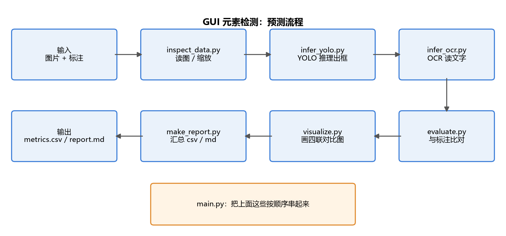
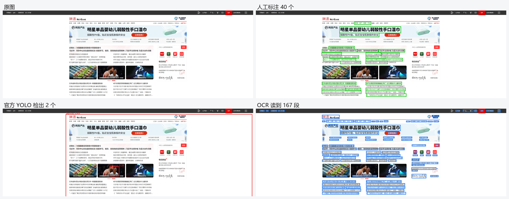
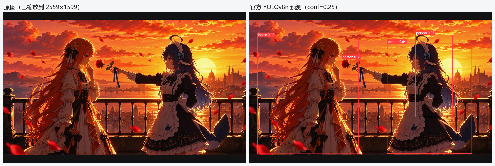
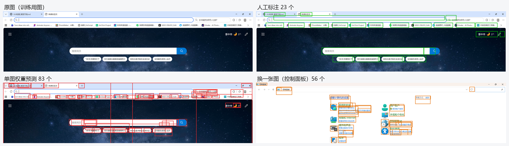
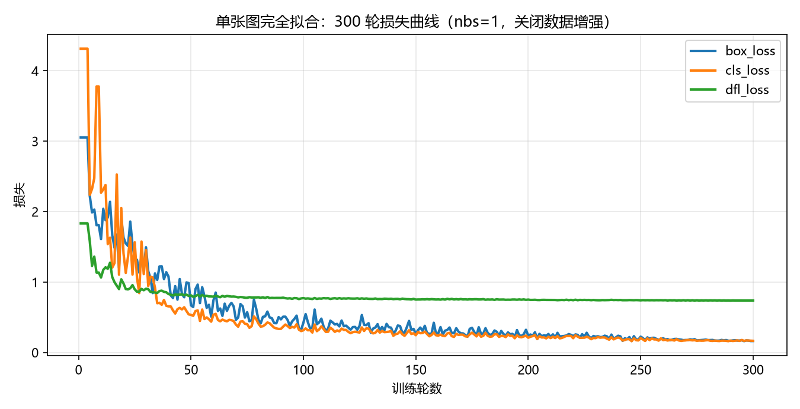
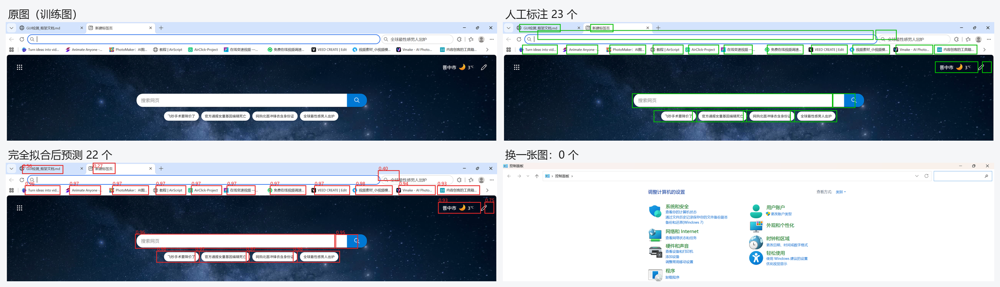
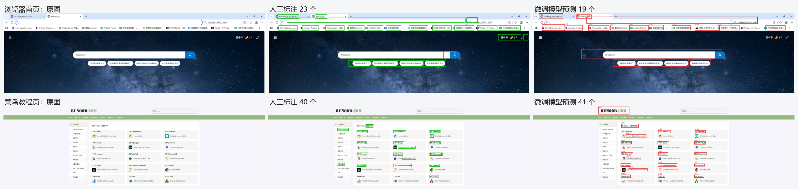

# 使用及训练说明

本项目用 YOLOv8n + EasyOCR 对桌面/网页截图做元素检测，并与人工标注比对评估，最后给出微调的完整流程。

**核心结论**：在未经领域适配的情况下，基于 COCO 预训练权重（`yolov8n.pt`）的通用目标检测模型对 GUI 截图的检测能力严重不足——两张测试图上最高置信度仅 0.49，且检出的类别（laptop、person）均为误判；COCO 的 80 类语义空间不包含 GUI 控件类别，模型无法将按钮、输入框、图标等元素映射到有效类别上。因此，要获得可用的检测效果，必须通过领域数据对模型进行微调。


## 一、预测

### 1.1 每个模块做什么



**数据流**：图片 + 标注 → 读入 → YOLO 出框 → OCR 读文字 → 与标注比对 → 画对比图 → 汇总成表。

| 模块 | 作用 | 输入 → 输出 |
|---|---|---|
| `config.py` | 路径、阈值等常量集中管理 | — |
| `inspect_data.py` | 读图、统一缩放、遍历图片 | 图片 → 数组 + 缩放比 |
| `infer_yolo.py` | 加载 YOLO 权重并推理 | 图片 → 检测框 |
| `infer_ocr.py` | 加载 OCR 模型并识别文字 | 图片 → 文本框 + 文字 |
| `evaluate.py` | 预测框与标注框做 IoU 匹配，算精确率/召回率 | 两组框 → TP/FP/FN、P、R |
| `visualize.py` | 把原图、标注、YOLO、OCR 画成四联对比图 | 图片 + 结果 → 对比图 |
| `make_report.py` | 把每张图的指标汇总成 CSV 和 Markdown | 指标列表 → `metrics.csv`、`report.md` |
| `main.py` | 按顺序调用上面各模块 | 目录 → 完整结果 |

**两个关键阈值**（都在 `config.py`）：

```text
YOLO_CONFIDENCE_THRESHOLD = 0.25   # 置信度低于它的框直接丢弃
IOU_THRESHOLD = 0.5                # 预测框与标注框的 IoU 超过它才算命中
```

### 1.2 运行结果

用官方权重 `yolov8n.pt`（未微调）、置信度阈值 0.25 跑一遍：



| 面板 | 内容 |
|---|---|
| 原图 | 输入截图（网易新闻首页） |
| 人工标注 | 人标的 40 个控件框（绿色） |
| 官方 YOLO | 只检出 2 个：`laptop 0.49`、`person 0.35`（红色） |
| OCR | 读到 167 段文字（蓝色） |

**结果很清楚：**

```text
人工标注 40 个控件
YOLO 检出 2 个，而且都是错认（把页面认成 laptop、person）
OCR 读到 167 段文字，覆盖了页面上大部分带文字的控件
```

**为什么 YOLO 这么差：COCO 的 80 个类别里没有“按钮、输入框、图标”这些词，它只能往 laptop、tv、person 上硬套。**

### 1.3 对照组：同一模型跑一张非 GUI 图片

为了确认"检不出"不是模型坏了，用**同一个权重、同一个阈值**再跑一张普通图片（原图 2739×1530，先等比缩放到 2559×1599，两侧补黑边）。



```text
检出 4 个框：
  person  0.64
  horse   0.42   ← 误判，其实是左边的人物
  person  0.31
  person  0.25
```

**说明两件事：**

```text
① 模型本身是正常的：它确实能认出"人"这个类别
② 它只认识 COCO 的 80 类：能认人、能认车，但"按钮、输入框、图标"这些词根本不在它的词表里
```

**所以 1.2 节 GUI 图上只检出 2 个框（还都是错认），不是模型坏了，而是它没有 GUI 这个概念。**

#### 1.3.1 置信度阈值试一下

**模型给出的置信度改不了（那是它自己算的），能改的只有阈值。** 同一张人像图，不同阈值：

| 阈值 | 检出数量 | 保留的框 |
|---|---|---|
| 0.25 | 4 | person 0.64 / horse 0.42 / person 0.31 / person 0.25 |
| 0.45 | 1 | person 0.64（其余三个都 < 0.45） |
| 0.60 | 1 | person 0.64 |
| **0.75** | **0** | 一个都不剩 |

而 GUI 那张图：0.25 时 2 个（laptop 0.49、person 0.35），0.45 时只剩 1 个，0.60 起就是 0 个——它的最高分才 0.49，阈值一旦超过 0.5 就全灭。

**结论：**

```text
阈值调高只能"过滤掉不够自信的框"，不能让它认识新东西
→ 人像图 0.75 一个不剩，GUI 图 0.60 起也是 0 个
→ 想让 GUI 上检出，只能换模型或微调，不是调阈值能解决的
```

## 二、训练说明

### 2.1 实验一：只用一张图训练（看"完全拟合"到底能不能做到）

**设置**

```text
起点权重：yolov8n.pt（COCO 预训练）
训练数据：只有 browser_home.png 一张图，人工标注 23 个框
训练轮数：50 轮
产物：train_output\gui_finetune\weights\best.pt
```

**结果**



| 测试图 | 真实框 | 预测框 | TP | FP | FN | 精确率 | 召回率 |
|---|---:|---:|---:|---:|---:|---:|---:|
| browser_home（训练图） | 23 | 83 | 14 | 69 | 9 | 0.169 | 0.609 |
| control_panel（新图） | 13 | 56 | 0 | 56 | 13 | 0.000 | 0.000 |
| ui_010（新图） | 40 | 67 | 0 | 67 | 40 | 0.000 | 0.000 |

**三个结论**

```text
① 50 轮远没有"完全拟合"
   训练图上召回率只有 0.61，23 个框里还漏了 9 个
   （默认 batch=8、nbs=64 → 每 8 轮才更新一次参数，50 轮总共只有约 6 次更新）

② 它学到的是"细长的文字块 = link"，不是"控件"
   训练图上预测了 83 个框，比人工标的 23 个还多
   → 把页面上所有文字块都框了一遍

③ 换一张图就完全失效
   control_panel 56 个预测、ui_010 67 个预测，TP 全是 0
   → 不是"检不出"，是"到处乱检"
   这就是过拟合最典型的表现：只认训练图的那张"皮"
```

**改进方向**：要真正拟合一张图，需要把 `nbs` 显式设成 1（每轮都更新）、关掉数据增强、把轮数提到几百轮。这个在 2.2 里做。

### 2.2 实验二：真正把一张图"完全拟合"

**实验一失败的原因**：默认 `nbs=64`，50 轮只更新了约 6 次参数。这次把更新次数补足。

**设置**

```text
起点权重：yolov8n.pt
训练数据：只有 browser_home.png（23 个框）
batch = 1，nbs = 1        ← 每轮都更新一次参数
数据增强：全部关闭（mosaic / flip / scale / hsv 全为 0）
优化器：SGD，lr0 = 0.01，无 warmup
轮数：300 轮
耗时：64 秒
```

**损失曲线**



| 轮数 | box_loss | cls_loss | dfl_loss |
|---:|---:|---:|---:|
| 1 | 3.053 | 4.313 | 1.833 |
| 10 | 1.610 | 2.269 | 1.065 |
| 50 | 0.669 | 0.534 | 0.811 |
| 100 | 0.422 | 0.315 | 0.772 |
| 200 | 0.241 | 0.209 | 0.751 |
| 300 | 0.163 | 0.165 | 0.738 |

（表中三项为 ultralytics 训练时自动计算的损失：`box_loss` 管框位置、`cls_loss` 管类别、`dfl_loss` 管边界精细度。）

**拟合效果**



| 测试图 | 真实框 | 预测框 | TP | FP | FN | 精确率 | 召回率 |
|---|---:|---:|---:|---:|---:|---:|---:|
| browser_home（训练图） | 23 | 22 | 22 | 0 | 1 | **1.000** | **0.957** |
| control_panel（新图） | 13 | 0 | 0 | 0 | 13 | 0.000 | 0.000 |
| ui_010（新图） | 40 | 0 | 0 | 0 | 40 | 0.000 | 0.000 |

**结论**

```text
① 完全拟合一张图很容易：300 次参数更新、64 秒，训练图上 P=1.0、R=0.96
② 但泛化能力是 0：换两张图，预测框数直接变成 0——连"乱检"都不做了
③ 它学到的不是"控件"，而是"这张图的像素分布"：
   换个页面就完全不认识，比实验一那种"到处乱检"更彻底的过拟合
```

**和实验一的对比**

| | 实验一（50 轮，默认 nbs） | 实验二（300 轮，nbs=1） |
|---|---|---|
| 训练图上的召回率 | 0.609 | **0.957** |
| 训练图上的预测框数 | 83（大量重复） | 22（几乎一一对应） |
| 换图后的表现 | 56 / 67 个乱检 | **0 个** |
| 说明 | 没学透，只会抓皮毛 | 学透了，但只会这一张 |

### 2.3 实验三：用 20 张左右截图微调（最终结果）

**设置**

```text
起点权重：yolov8n.pt
训练数据：21 张截图（16 张训练 / 5 张验证），其中 1 张人工精标、20 张 OCR 弱标注
类别：button / input / icon / link / other
轮数：50 轮，batch = 4
产物：weight\\best.pt
```

**结果**



| 测试图 | 真实框 | 预测框 | TP | FP | FN | 精确率 | 召回率 |
|---|---:|---:|---:|---:|---:|---:|---:|
| browser_home | 23 | 19 | 18 | 1 | 5 | 0.947 | 0.783 |
| ui_013（菜鸟教程） | 40 | 41 | 31 | 10 | 9 | 0.756 | 0.775 |
| 全部 21 张合计 | 652 | 211 | 141 | 70 | 511 | **0.668** | **0.216** |

**结论**

```text
① 能识别了：同类页面（浏览器首页、教程页）P≈0.75~0.95、R≈0.78
② 整体召回率只有 0.22，原因有两个：
   · 20 张图的标注是 OCR 弱标注，只框了文字块，很多控件没标 → 漏检数被高估
   · 小图标、纯图形按钮没有文字，OCR 标不出来，模型也没学会
③ 但和官方权重对比，已经是质的变化：官方是 0~2 个框且全错，微调后能真检出一批
```

**三组实验对比**

| | 实验一（1 图 / 50 轮） | 实验二（1 图 / 300 轮） | 实验三（21 图 / 50 轮） |
|---|---|---|---|
| 训练图召回率 | 0.609 | 0.957 | 0.783 |
| 训练图精确率 | 0.169 | 1.000 | 0.947 |
| 换新图 | 56 / 67 个乱检 | 0 个 | 能检出（P 0.67 / R 0.22） |
| 结论 | 没学透 | 死记一张 | 学到了一点通用特征 |

**这说明：数据量比轮数重要。** 一张图练到 loss 接近 0，换图还是 0；21 张图练 50 轮，虽然每项指标都不高，但至少能在新图上检出东西。

## 特别提醒
仅供学习, 切勿商用  

## 特别鸣谢
白饭鲸227