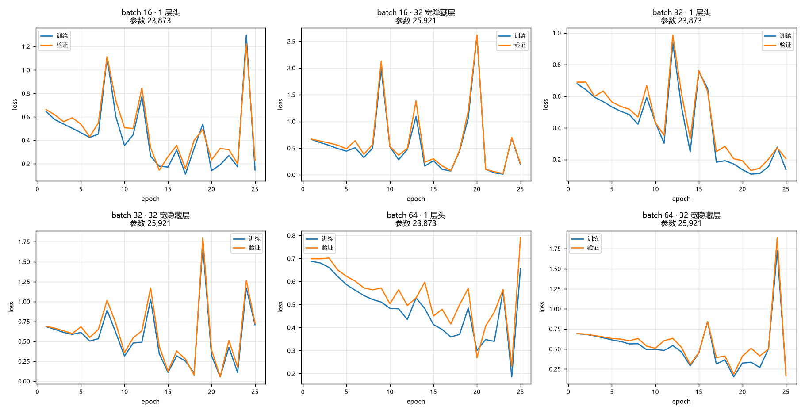
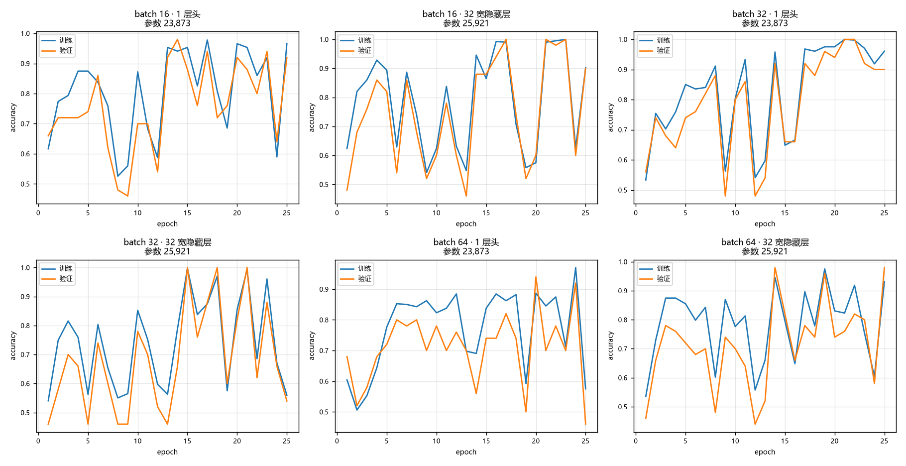
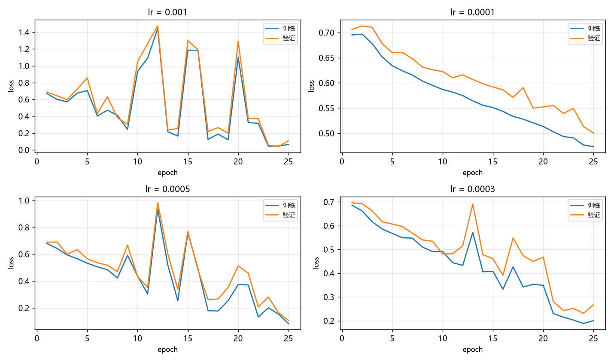
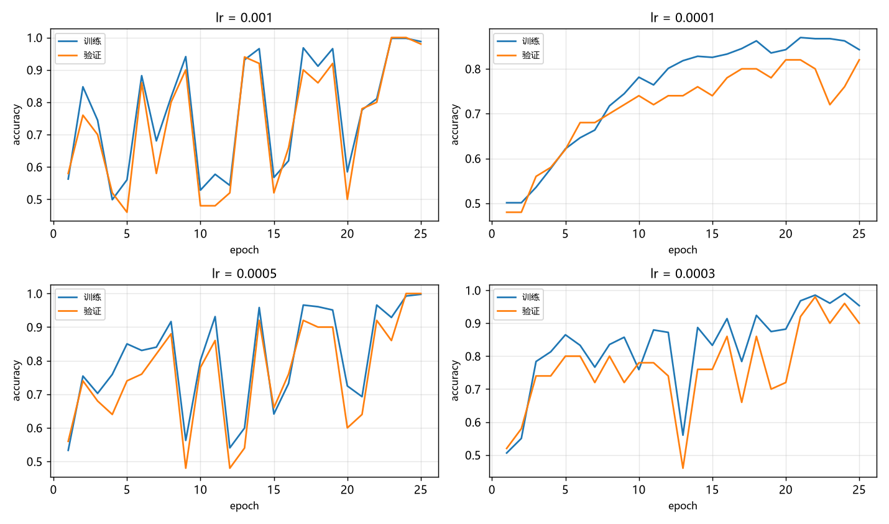
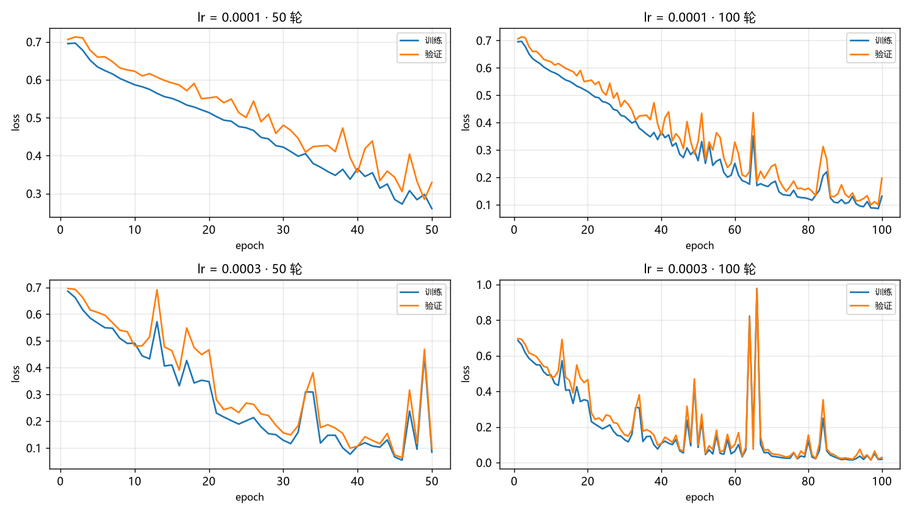
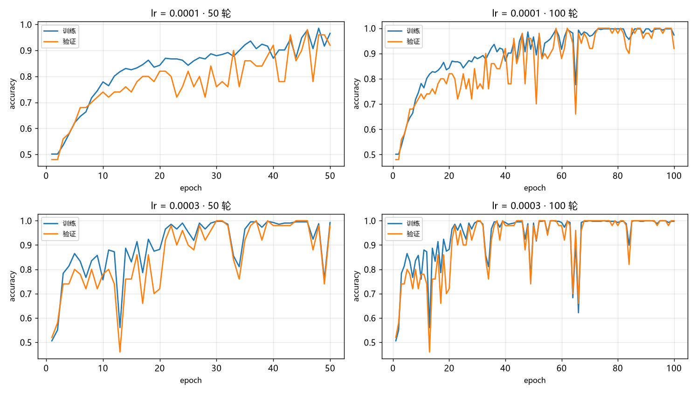
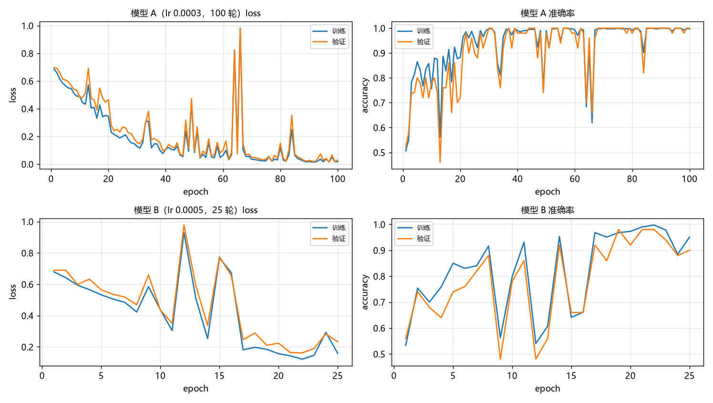
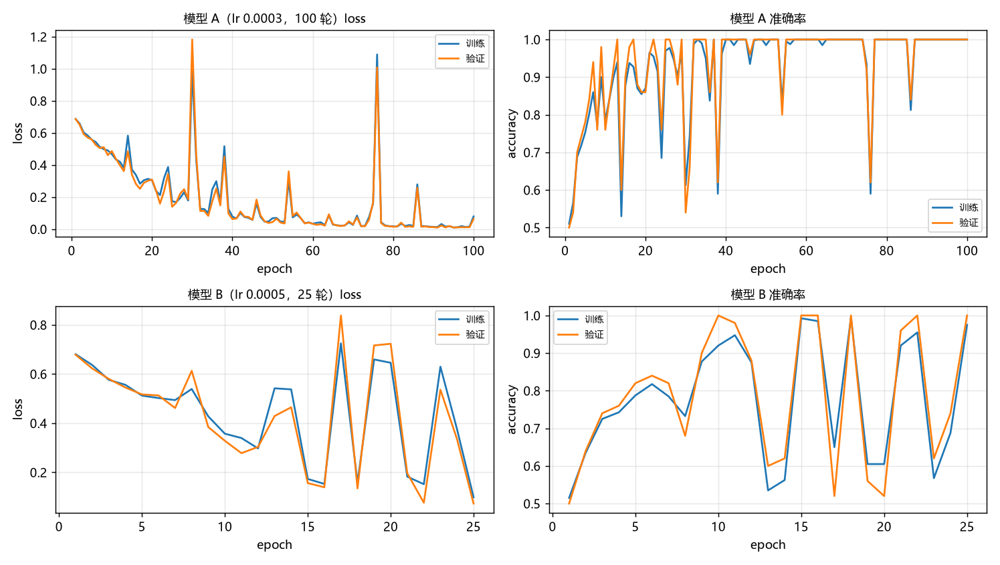
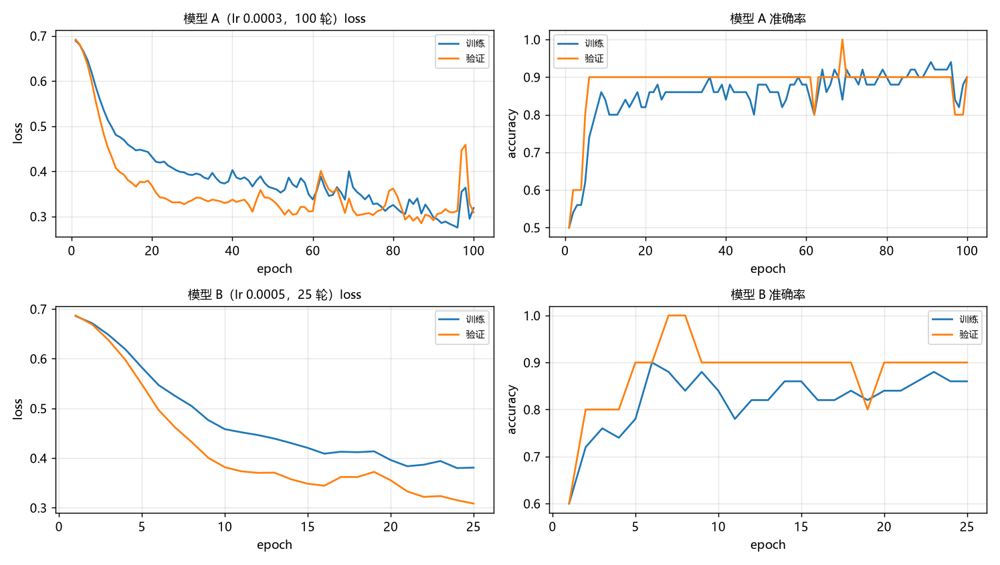

# 模型设计及分析

## 模型设计

### 各模块功能

1. `inspect_data.py` 负责将数据转化为张量并缓存
2. `dataset.py` 负责将张量批量打包
3. `model.py` 模型结构
4. `train.py` 训练模型
5. `evaluate.py` 模型评估
6. `predict.py` 图片预测

### 使用步骤

`inspect_data.py` -> `train.py` -> `evaluate.py` -> `predict.py`

### 设计说明

模型参数较小，因此采用 3 层卷积 + 1 层全连接，默认训练 25 轮，只在卷积层使用激活函数。
使用 GAP（全局平均池化）替代 Flatten，防止过拟合、提高泛化能力。

## 分析

数据集共 507 张：登录页 257 张、其他页 250 张。其中 7 张为真实截图，其余 500 张由脚本合成。
所有对照实验固定训练 25 轮，学习率 5e-4，weight_decay 5e-4，输入统一 128×128，训练时只做水平翻转增强。

### 实验 1：批大小 × 分类头

六组对照，两个变量：批大小（16 / 32 / 64）、分类头（1 层 `Linear(64,1)` / 2 层 `Linear(64,32)→ReLU→Linear(32,1)`）。

**损失曲线**

**准确率曲线**

| 批大小 | 分类头 | 参数量 | 步/轮 | 最佳验证 acc | 末轮验证 acc | 最大验证 loss | 末轮验证 loss |
|---|---:|---:|---:|---:|---:|---:|---:|
| 16 | 1 层 | 23,873 | 25 | 0.98 | 0.92 | 1.22 | 0.23 |
| 16 | 2 层 | 25,921 | 25 | 1.00 | 0.90 | 2.62 | 0.21 |
| 32 | 1 层 | 23,873 | 12 | 1.00 | 0.90 | 0.99 | 0.21 |
| 32 | 2 层 | 25,921 | 12 | 1.00 | 0.54 | 1.80 | 0.73 |
| 64 | 1 层 | 23,873 | 6 | 0.94 | 0.46 | 0.79 | 0.79 |
| 64 | 2 层 | 25,921 | 6 | 0.98 | 0.98 | 1.89 | 0.16 |

### 结论

- 分类头层数不是主因：参数量从 23,873 增加到 25,921 后，抖动没有减小，在 batch 16 / 32 下反而更明显；batch 64 下 2 层头末轮反而更好，说明层数与稳定性之间没有单调关系。
- 批大小在 16 ~ 32 之间影响不大，两者都能收敛到 0.90 以上；batch 64 每轮只有 6 步、25 轮共 150 步，训练不足，末轮指标明显偏低。
- 六组的训练 loss 与验证 loss 都同步出现尖峰，说明波动来自权重更新的幅度，与验证集大小、BN 统计量无关。
- 因此主因指向学习率与训练步数，参数量已被本次实验排除。后续用实验 2（学习率）与实验 3（轮数）进一步验证。

### 实验 2：学习率

固定 batch 32、1 层分类头、25 轮，只改学习率（1e-3 / 1e-4 / 5e-4 / 3e-4）。

**损失曲线**

**准确率曲线**

| 学习率 | 参数量 | 步/轮 | 最佳验证 acc | 末轮验证 acc | 最大验证 loss | 末轮验证 loss |
|---:|---:|---:|---:|---:|---:|---:|
| 1e-3 | 23,873 | 12 | 1.00 | 0.98 | 1.47 | 0.11 |
| 1e-4 | 23,873 | 12 | 0.82 | 0.82 | 0.71 | 0.50 |
| 5e-4 | 23,873 | 12 | 1.00 | 1.00 | 0.98 | 0.11 |
| 3e-4 | 23,873 | 12 | 0.98 | 0.90 | 0.70 | 0.27 |

### 结论

- 学习率越高，曲线震荡越明显：1e-3 的最大验证 loss 达 1.47，5e-4 为 0.98，3e-4 和 1e-4 都在 0.7 左右。
- 25 轮内收敛最好的是 5e-4（末轮验证 acc 1.00、末轮 loss 0.11）；1e-4 虽然最平滑，但只到 0.82，属于没训完。
- 1e-4 与 3e-4 的曲线明显更平，说明降低学习率能减少震荡；但低学习率需要更多轮数才能收敛。
- 因此"学习率低一点更好"目前只能算趋势：低学习率换来的稳定，可能是"没学完"造成的假象。
  补充跑 50 / 100 轮时，低学习率会出现训练集拟合很好、验证集泛化变差的情况，需要靠实验 3（轮数）确认。

### 实验 3：轮数

在实验 2 的基础上把轮数加到 50 / 100 轮，学习率取 1e-4 与 3e-4，其余固定（batch 32、1 层头）。

**损失曲线**

**准确率曲线**

| 学习率 | 轮数 | 参数量 | 最佳验证 acc | 末轮训练 acc | 末轮验证 acc | 末轮训练 loss | 末轮验证 loss | 最大验证 loss |
|---:|---:|---:|---:|---:|---:|---:|---:|---:|
| 1e-4 | 50 | 23,873 | 0.98 | 0.97 | 0.92 | 0.260 | 0.329 | 0.71 |
| 1e-4 | 100 | 23,873 | 1.00 | 0.97 | 0.92 | 0.131 | 0.197 | 0.71 |
| 3e-4 | 50 | 23,873 | 1.00 | 0.99 | 0.98 | 0.084 | 0.098 | 0.70 |
| 3e-4 | 100 | 23,873 | 1.00 | 1.00 | 1.00 | 0.018 | 0.029 | 0.97 |

### 结论

- 只看 100 轮：3e-4 在 80 轮之后曲线基本贴平，末轮训练/验证准确率都是 1.00、验证 loss 0.029；
  1e-4 末轮验证准确率只有 0.92、验证 loss 0.197，尾部仍在起伏。**3e-4 是更合适的学习率。**
- 1e-4 的问题不是"不稳"，而是"走得慢、没走到位"：给了 100 轮仍然没有收敛到同样水平。
- 3e-4 在 66 轮附近出现过一次尖峰（验证 loss 0.97），随后自行恢复。该现象暂不解释，
  留待后续实验验证（初步猜想与数据分布、泛化有关）。
- 本实验只讨论拟合能力：3e-4 + 100 轮可以把训练集和验证集都拟合到接近完美。
  但验证集同样是合成图，**这不能说明泛化能力好**，泛化留到后续实验单独评估。

### 实验 4：泛化能力

用两个模型对比：A 是实验 3 里收敛最好的那组（3e-4 / 100 轮），B 是最初选定的那组（5e-4 / 25 轮）。
两者结构相同：3 层卷积 + 1 层分类头，batch 32。

**两个模型的训练结果**

| 模型 | 学习率 | 轮数 | 参数量 | 末轮训练 loss | 末轮训练 acc | 末轮验证 loss | 末轮验证 acc |
|---|---:|---:|---:|---:|---:|---:|---:|
| A | 3e-4 | 100 | 23,873 | 0.018 | 1.00 | 0.029 | 1.00 |
| B | 5e-4 | 25 | 23,873 | 0.160 | 0.95 | 0.234 | 0.90 |

**预测结果**（概率为"是登录页"的把握，> 0.5 判为登录页）

| 图片 | 说明 | 真实类别 | 模型 A 概率 | 模型 A 结果 | 模型 B 概率 | 模型 B 结果 |
|---|---|---|---:|---|---:|---|
| bilibili.png | 真实截图：登录页 | 登录页 | 0.704 | 登录页 ✅ | 0.852 | 登录页 ✅ |
| edge.png | 真实截图：非登录页（浏览器主页） | 其他页 | 0.977 | 登录页 ❌ | 0.983 | 登录页 ❌ |
| synth_login.jpg | 合成图：登录页 | 登录页 | 0.990 | 登录页 ✅ | 0.987 | 登录页 ✅ |
| synth_other.jpg | 合成图：其他页 | 其他页 | 0.003 | 其他页 ✅ | 0.160 | 其他页 ✅ |

### 结论

- 两个模型的泛化能力都很差，模型 A 更明显：它对合成图这类"标准形状"拟合得极好（0.990 / 0.003），
  但遇到真实截图就失效。
- 模型的行为可以概括为：**只要不是训练时见过的那种"居中卡片"结构，就一律判成登录页。**
  edge.png 是普通的浏览器主页，模型给出的概率高达 0.977 / 0.983，属于"自信地错"。
- 即便是判对的 bilibili.png，概率也只有 0.704 / 0.852，明显低于合成图的 0.99，
  说明这一张更像是"猜对"，而不是真的识别出了登录页。
- 原因指向训练数据：250 张合成图结构高度相似，只有 7 张是真实登录页，
  数据过于单一，模型学到的是合成图的版式，而不是"登录页"这个概念。
- 由此提出下一个问题：这 7 张真实图片是否反而成了干扰项？移除它们之后，
  模型对合成图的拟合是否会更好？这由实验 5 验证。

### 实验 5：移除 7 张真实登录页

把 data/login 里的 7 张真实截图去掉，只保留 250 张合成登录页 + 250 张合成其他页（共 500 张）。
模型与实验 4 完全相同：A（3e-4 / 100 轮）、B（5e-4 / 25 轮），batch 32、1 层头。

| 模型 | 学习率 | 轮数 | 参数量 | 训练/验证 | 末轮训练 loss | 末轮训练 acc | 末轮验证 loss | 末轮验证 acc |
|---|---:|---:|---:|---|---:|---:|---:|---:|
| A | 3e-4 | 100 | 23,873 | 400 / 50 | 0.079 | 1.00 | 0.064 | 1.00 |
| B | 5e-4 | 25 | 23,873 | 400 / 50 | 0.099 | 0.97 | 0.073 | 1.00 |

**预测结果**

| 图片 | 说明 | 真实类别 | 模型 A 概率 | 模型 A 结果 | 模型 B 概率 | 模型 B 结果 |
|---|---|---|---:|---|---:|---|
| bilibili.png | 真实截图：登录页 | 登录页 | 0.090 | 其他页 ❌ | 0.597 | 登录页 ✅ |
| edge.png | 真实截图：非登录页（浏览器主页） | 其他页 | 0.788 | 登录页 ❌ | 0.946 | 登录页 ❌ |
| synth_login.jpg | 合成图：登录页 | 登录页 | 0.930 | 登录页 ✅ | 0.964 | 登录页 ✅ |
| synth_other.jpg | 合成图：其他页 | 其他页 | 0.003 | 其他页 ✅ | 0.060 | 其他页 ✅ |

**合成测试集上的平均概率**（50 张未参与训练：21 张登录 + 29 张其他）

| 模型 | 登录页平均概率 | 其他页平均概率 | 准确率 |
|---|---:|---:|---:|
| A | 0.859 | 0.022 | 1.000 |
| B | 0.954 | 0.143 | 0.980 |

### 结论

- 去掉 7 张真实图后，模型 A 对真实登录页的概率从 0.704 掉到 0.090，直接判错；
  说明这 7 张虽然少，却是模型唯一的真实数据来源，**不能算作噪声**。
- 模型 B 在真实登录页上给出 0.597，只是勉强过线；真实非登录页两个模型都判错
  （0.788 / 0.946），说明真实场景下的判断基本靠猜或靠默认。
- 合成测试集（未参与训练的 50 张）上，A 的登录/其他平均概率为 0.859 / 0.022，
  B 为 0.954 / 0.143，两者准确率 1.000 与 0.980：
  **在同分布的合成数据上拟合都很好，A 的区分度更大一些。**
- 但这只能说明"同分布内表现好"，不能说明泛化能力；真实图片上仍然失效。
- 100 轮相对 25 轮没有带来实际收益：B 只用 25 轮就到 0.980，真实图上也未明显更差。
  该判断目前只有 2 张真实图支撑，只能算线索。
- 关于过拟合：同一批结构高度相似的图片上，训练轮数增加后（A 100 轮 vs B 25 轮），
  合成测试集的准确率从 0.980 升到 1.000，但真实图片的表现从 0.597 掉到 0.090。
  也就是说，**训练轮数增加让模型更贴合训练分布，同时对分布外数据更差**。
  这种过拟合没有体现在"训练/验证差距"上（两者验证集都是 1.00），
  而是在换一种数据分布时才暴露出来。

### 实验 6：改用真实截图训练

数据换成真实截图：用无头浏览器抓取各站点页面，人工剔除标错/空白的图后，
登录页与其他页各取 35 张（共 70 张），两类数量相同。模型结构与实验 4/5 一致。

| 模型 | 学习率 | 轮数 | 参数量 | 训练/验证/测试 | 末轮训练 loss | 末轮训练 acc | 末轮验证 loss | 末轮验证 acc | 测试 acc |
|---|---:|---:|---:|---|---:|---:|---:|---:|---:|
| A | 3e-4 | 100 | 23,873 | 50 / 10 / 10 | 0.319 | 0.90 | 0.309 | 0.90 | 0.90 |
| B | 5e-4 | 25 | 23,873 | 50 / 10 / 10 | 0.381 | 0.86 | 0.308 | 0.90 | 0.80 |

**预测结果**

| 图片 | 说明 | 真实类别 | 模型 A 概率 | 模型 A 结果 | 模型 B 概率 | 模型 B 结果 |
|---|---|---|---:|---|---:|---|
| bilibili.png | 真实截图：登录页 | 登录页 | 0.548 | 登录页 ✅ | 0.458 | 其他页 ❌ |
| edge.png | 真实截图：非登录页（浏览器主页） | 其他页 | 0.285 | 其他页 ✅ | 0.361 | 其他页 ✅ |
| synth_login.jpg | 合成图：登录页 | 登录页 | 0.587 | 登录页 ✅ | 0.622 | 登录页 ✅ |
| synth_other.jpg | 合成图：其他页 | 其他页 | 0.348 | 其他页 ✅ | 0.378 | 其他页 ✅ |

**错例**（测试集判错的样本 + 判错的 bilibili.png）

| 模型 | 判错的图 | 真实类别 | 概率 | 判成 |
|---|---|---|---:|---|
| A | login_jianshu.png（简书登录页，页面被弹窗遮挡） | 登录页 | 0.43 | 其他页 |
| B | bilibili.png | 登录页 | 0.46 | 其他页 |
| B | login_zhihu.png（知乎登录页） | 登录页 | 0.30 | 其他页 |
| B | other_ifanr2.png（ifanr 内容页，加载失败只剩报错插图） | 其他页 | 0.54 | 登录页 |

### 结论

- 改用 70 张真实截图训练后，模型 A 四张测试图全部判对，模型 B 对 3 张
  （真实登录页 0.458 低于阈值而判错）。
- 与实验 4/5（纯合成训练）相比，关键差别在真实非登录页：
  纯合成训练时它被判成登录页（0.977 / 0.788），真实数据训练后降到 0.285 / 0.361，
  **这是真实数据带来的直接改善。**
- 同时，合成图仍然判对（0.587 / 0.348），说明换成真实数据后并没有丢掉对合成版式的识别能力。
- 但概率普遍不高（0.28 ~ 0.62），且测试集只有 10 张，说明 70 张仍然偏少，
  训练集准确率只有 0.90，还处在欠拟合阶段。这组结果只能作为趋势，不能当作定量结论。
- 趋势上可以认为：**真实数据能带来跨分布（真实 ↔ 合成）的判断能力，合成数据做不到这一点；
  但真实数据同样需要足够的数量，几十张只能让模型"够用"，谈不上"训练充分"。**

## 六组实验总结

**一句话**：决定这个模型能用不能用的，是**训练数据的分布**，不是参数量、批大小、分类头层数或训练轮数。

| 实验 | 变量 | 结论 |
|---|---|---|
| 1 | 批大小（16/32/64）× 分类头（1 层/2 层） | 分类头层数是次要因素，参数从 23,873 加到 25,921 抖动没有变小；batch 16~32 差别不大，batch 64 因为每轮只有 6 步而训练不足 |
| 2 | 学习率（1e-3 / 5e-4 / 3e-4 / 1e-4） | 学习率越大震荡越大；25 轮内 5e-4 收敛最好（末轮 acc 1.00）；1e-4 最平但只到 0.82，属于没训完 |
| 3 | 轮数（50 / 100）× 学习率（1e-4 / 3e-4） | 100 轮下 3e-4 最稳（末轮 acc 1.00、loss 0.029）；1e-4 跑满 100 轮仍只有 0.92，说明"低学习率的平稳"可能是没学完 |
| 4 | 纯合成数据训练，测真实页面 | 泛化能力很差：只要不是合成图那种"居中卡片"版式，一律判成登录页（真实非登录页概率 0.977） |
| 5 | 去掉 7 张真实图 | 真实登录页概率从 0.704 掉到 0.090，说明那 7 张是唯一的真实数据来源，不是噪声；轮数增加只提升同分布精度，不提升跨分布能力 |
| 6 | 换成 70 张真实截图训练 | 模型 A 四张测试图全对，真实非登录页概率从 0.977 降到 0.285；说明真实数据能带来跨分布判断能力，但 70 张仍偏少（训练 acc 0.90） |

**三条可以直接写进报告的判断**

1. **参数量不是瓶颈**：23,873 已经够用，继续加宽分类头（+2,048）或用 100 轮训练，
   在"同分布"上几乎没有提升，在"跨分布"上反而更差。
2. **超参只影响收敛速度和稳定性**：学习率决定曲线抖不抖、轮数决定收不收敛，
   但它们不改变"模型能学到什么"——那是数据决定的。
3. **数据分布决定上限**：同一套网络，纯合成数据训练会在真实页面上失效；
   换成 70 张真实截图，同一个网络就能同时判对真实页和合成页。
   因此真实数据不能被合成数据替代，合成数据只能作为补充。

## 补充
六组实验在AI辅助下完成, 以上结论, 仅供参考 

## 特别鸣谢
白饭鲸227
